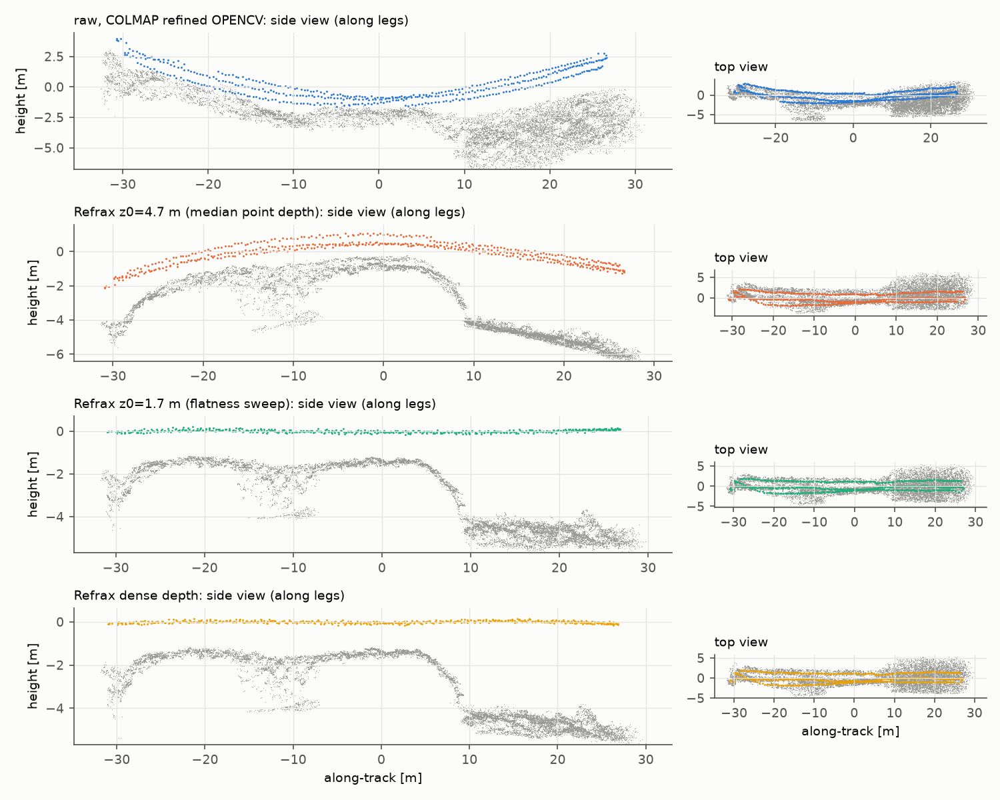
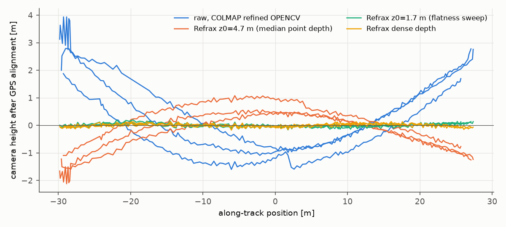
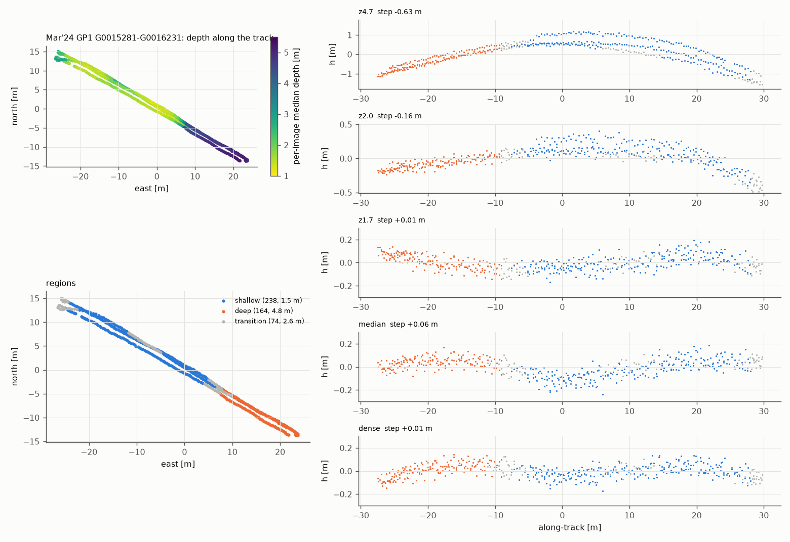
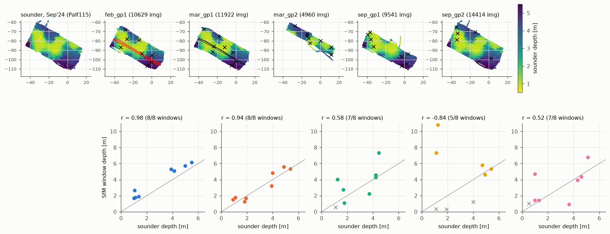
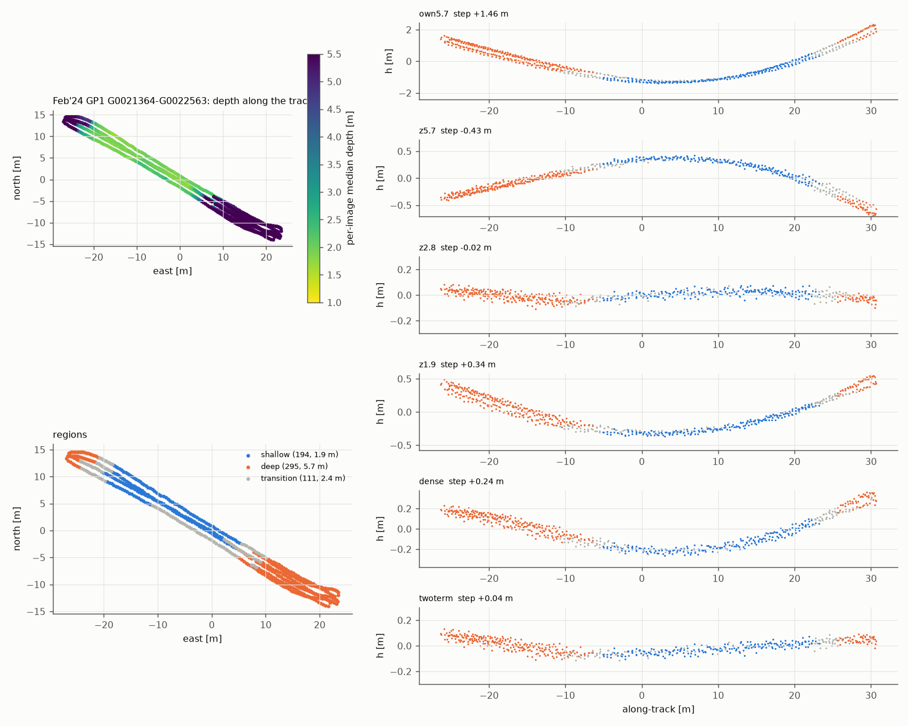

# Exploration: Lizard Island (real reef), self-calibration and depth-aware correction

Branch `explore/lizard` (based on `explore/depth`, with `explore/speed` merged in). All
numbers come from the scripts in `depth_aware/` (`lizard_*.py`, `synthetic_ba.py`); figures
are in `docs/figures/lizard_*.png`. Large outputs (images, COLMAP databases, depth maps) are
in `/Users/fischert/robot/refrax-work/lizard/`. The image data stay on this Mac
(`/Users/fischert/robot/refrax-data/lizard_mar24_gp1/`). They are restricted to the group:
do not upload or share them.

## TL;DR

Real reef: 476 images from three 55 m survey legs of the paper's `mar_gp1`, GPS as the
flatness reference. Same images, matching and fixed intrinsics in every run.

| | reg. | reproj [px] | κ_traj | GPS v-RMS | leg sag |
| --- | --- | --- | --- | --- | --- |
| raw, COLMAP refined OPENCV | 469/476 | 0.519 | +0.748 | 1.25 m | +3.56 m |
| Refrax z0 = 4.7 m (median point depth) | 476 | 0.418 | −0.160 | 0.67 m | −1.91 m |
| Refrax z0 = 1.7 m (self-calibrated, paper's sweep) | 476 | 0.419 | +0.006 | 0.065 m | +0.08 m |
| per-image median depth | 476 | 0.417 | +0.009 | 0.074 m | +0.12 m |
| dense depth (SfM + Depth Anything V2) | 476 | 0.416 | −0.003 | 0.059 m | −0.03 m |
| dense depth + virtual centre | 476 | 0.416 | +0.007 | 0.067 m | +0.10 m |

1. **Self-calibration works as in the paper.**
   - Estimated:
     - the underwater focal length and principal point, from COLMAP on the raw images;
     - in-air f = f_w / 1.34, no lens distortion;
     - z0, from trajectory flatness.
   - The housing is nominal (d0 = 2 cm).
   - Result: a flat trajectory (κ +0.006, against the paper's +0.014).
   - Converting the full underwater model (including k1, k2) to air instead reproduces
     the raw self-calibration and its bowl. Keep the paper's rule.
2. **z0 is the critical parameter, and it is not "the scene depth".**
   - The median point depth (4.7 m) domes the trajectory by −1.9 m.
   - The flattest constant is 1.7 m, the *typical per-frame* depth: coral heads at
     1.4–2.3 m and sand at ~5 m.
   - Reprojection error, points and track length are blind to z0: 0.418 vs 0.419 px.
3. **Depth-aware correction helps in a specific way.** One pass from the *wrong* z0
   (per-image median or dense depth from that run's SfM, scale from GPS) is as flat as the
   swept z0, with no sweep and no prior.
   - It does **not** beat the well-tuned constant z0.
   - Dense per-pixel depth adds nothing measurable over one depth per image: it changes
     the images by 0.03 px beyond the per-image median.
   - The reprojection gain is 0.002 px.
4. **The virtual-centre + dense-depth failure on gopro10 was a COLMAP initialisation
   accident**, not a geometry bug.
   - Re-running the mapper on the same database with seed 1 or 2 gives 0.481 px, the best
     gopro10 result.
   - A synthetic multi-view BA shows no bending for any depth-aware variant, with or
     without the virtual centre.
5. **Region-wise (§9): one z0 is a mild compromise, and depth-awareness does not beat it.**
   - Every GoPro1 survey crosses a coral platform (1.5–1.9 m) and sand (4.8–5.7 m) on
     every leg, including the §5 subset. A second stretch (Feb'24, 1.9 / 5.7 m) was
     selected with the ASV's echo-sounder map and SfM spot checks.
   - Per region, the flattest z0 lies between the two levels (Mar 1.7 / 2.0 m, Feb
     2.5 / 3.3 m), not at the region's depth. A single tuned z0 keeps both regions within
     ±30 mm sag over 20 m. There is no height step between the regions in any run.
   - Per-image and dense depth tie with the tuned z0 on Mar'24. They are 4.6x worse in
     v-RMS on Feb'24 (0.16 vs 0.034 m), because the real depth-dependent refraction is
     ~5x weaker than the nominal d0 = 2 cm. Two depth levels make this separable from the
     intrinsics error.
6. `explore/speed` is merged. The depth pipeline uses the exact per-pixel inverse, with
   the virtual centre in the analytic model and the numba kernels. 48 tests pass.


---

## 1. Merge of `explore/speed`

`explore/speed` is merged (merge commit `324ed73`). Conflicts in `remove_refraction.py`,
`core/scale.py` and `pixi.toml` were resolved by taking the speed implementation and putting
the depth branch's features back on top of it:

- **Virtual centre in the analytic model.** With the corrected pinhole at `(0, 0, c)`, the
  point at depth `Z` projects to `(A Z + B) / (Z − c) = A + (B + c A) w'`, with
  `w' = 1 / (Z − c)`. This is the speed branch's model with `B → B + cA` and `w → 1/(Z − c)`.
  It is implemented in:
  - `core/flatport.FlatPort(center_z=)`;
  - both numba kernels (`P[7]`);
  - `InverseMapper(center_z=)`, which takes depth from the camera centre and shifts it
    internally;
  - `forward_map_analytic` and `select_zoom`.
- **`depth_crop: reference`** (one calibration file in depth mode) is back in the
  pipelined CLI.
- **The depth pipeline now uses the exact inverse.** `depth_aware/common.Corrector.out_to_ideal_map`
  calls `InverseMapper` instead of its own step-4 griddata inverse, so depth maps are
  sampled per pixel. Depth maps are also saved as float32 now: float16 quantised them to
  about 1e-3 relative.
- **Tests.** `pixi run test` passes all 48 tests. New ones cover:
  - the depth-mode CLI in both crop modes;
  - the virtual-centre forward model against the 3-D ray tracer (< 1e-9 px);
  - virtual-centre inverse maps against the ray tracer, for constant, smooth and step depth,
    an on-axis and a tilted port, and both backends (< 1e-5 px at p99.9). The depth map is
    interpolated in `1/(Z − c)`.

## 2. Data: the subset

**Source.** On the HPC, `Serena_Mou_Data/LIRS_Mar_24/South_Palfrey_1/GoPro1/` holds 11,922
GoPro HERO11 Black JPGs (8:7 photo mode, 5568x4872, EXIF focal 2.71 mm / 15 mm equivalent).
The pose CSV `march_south_palf_1-GP1.csv` has (name, lat, lon, height), and all heights are 0.
This is the paper's `mar_gp1` (Table I: "Mar 2024 01", 11,828 frames, Z = 1–8 m).

**Subset choice** (`docs/figures/lizard_subset.png`).

- The survey is a lawn-mower pattern of ~55 m legs at a heading of 120°/300°, about 2 m
  apart, with ~325 images per leg (0.17 m spacing).
- I took **951 contiguous images, `G0015281`–`G0016231`**: three complete legs, from turn
  to turn, in the middle of the survey (105/106GOPRO). That is 2.8 GB, copied with rsync from
  the data-transfer node.
- Three legs give the reconstruction a 2-D extent (55 m x 3 m), cross-leg overlap, and leg
  turns, as in the paper's trajectories. The VSLAM-LAB `LIRS_Mar_24_GoPro1-s01` subset
  (centre `G0015930`) lies inside it.
- Every 2nd image is used: **476 images, 0.34 m apart**. Every 4th image (0.68 m) already
  breaks the reconstruction: only 156/238 images register.
- Images are downscaled 6x to 928x812 with area averaging. The paper used 593x518.

**GPS.**

- The receiver updates at about half the image rate, so 56 % of consecutive images repeat
  a fix, and 3.5 % of the steps are jumps > 0.6 m.
- `lizard_prep.py` repairs single-epoch jumps (as VSLAM-LAB's loader does) and interpolates
  between fix changes.
- It converts the track to local east/north metres.
- It builds the **match pair list: all pairs within 4 m** (14,629 pairs, 61 per image). The
  same list is used for every COLMAP run, so the runs differ only in the images.

**Scene depth.** The raw reconstruction, scaled to metres with GPS, puts the sparse points at
a median of **4.7 m** below the camera (p5–p95: 1.4–5.6 m).

- Table corals reach to ~1.4 m, sand channels lie at 5+ m.
- Within one image the depth typically varies by a factor of 1.3 (p95/p5 of the dense depth
  map, median image).


## 3. Self-calibration of the GoPro HERO11 + housing

**What the paper did.** The paper's Lizard Island configuration is still in the git history
(`configs/lizardisland.yaml`, commits `5204038`…`faea17b`):

- 593x518 images;
- `fx, fy = 383.418 / 1.33, 382.382 / 1.33`;
- `cx, cy = 296.892, 260.068`;
- no distortion;
- `d0 = 2 cm`, `tglass = 2 mm`, `z0 = 1.0–1.5 m`.

The 383.4 px focal length is an *underwater* COLMAP self-calibration, divided by the
paraxial magnification of a flat port. Section VI then picks `z0` by reconstructing for
several candidates and keeping the flattest result (Fig. 7). So the self-calibration
estimates:

- the focal length and principal point, from SfM on the raw images;
- one depth parameter, z0, from a planarity prior.

The housing stays nominal. The HPC also has GP11 in-air calibration *videos*
(`Lizard_Island/GOPRO/GP11_calib_air_linear_*.MP4`). They are in a video mode, not this
photo mode, so I did not use them.

**What is estimated here** (`lizard_calib.py`, `refrax-work/lizard/calib.json`). Values are
for the 928x812 images.

| step | how | result |
| --- | --- | --- |
| 1. underwater intrinsics | COLMAP on the 476 raw images, OPENCV model, intrinsics refined in BA (this is also the "raw" baseline run) | f_w = 589.89 / 590.44 px, c = (466.05, 404.77), k1 = 0.315, k2 = 0.402, p1, p2 ≈ 0 |
| 2. in-air intrinsics (paper's rule) | f_air = f_w / mu_w with mu_w = 1.34, principal point kept, k = p = 0 | f_air = 440.22 / 440.63 px |
| 2'. alternative: Snell conversion | every pixel's underwater ray (step 1) is refracted back into air with Snell's law (flat port, so the glass drops out), and an in-air OPENCV model is fitted to pixel → air ray | f_air = 437.58 / 437.96, k1 = −0.0077, k2 = −0.0029; fit 0.21 px RMS |
| 3. housing | nominal: d0 = 2 cm, tglass = 2 mm, mu_w = 1.34 | not estimated (Z/d0 is what matters, so d0 and z0 are interchangeable) |
| 4. z0 (paper's sweep) | trajectory flatness (the ASV keeps the camera at constant height): fixed-depth runs at z0 = 4.7 m and 2.0 m give a leg sag of −1.91 m and −0.43 m. The sag is close to linear in 1/z0, with a zero at 1.72 m (κ_traj gives 1.73 m). Checked with a run at z0 = 1.7 m (§5). | **z0* = 1.7 m** |

What the steps show:

- **The GoPro lens itself is nearly distortion-free in air.**
  - The Snell conversion gives k1 = −0.008.
  - An older VSLAM-LAB self-calibration (`LIZARDISLAND/LIRS_MAR1`, 556x486) converts to
    k1 = −0.007.
  - So the +0.3 pincushion seen underwater is almost all refraction, and the paper's
    "k = 0" is justified. f_w / mu_w is within 0.6 % of the converted focal length.
- **Still, the paper's rule is the better choice.**
  - Refrax with the Snell model reproduces COLMAP's raw underwater self-calibration to
    0.28 px RMS (0.5 px max) at z0 = 4.7 m.
  - That self-calibration was estimated jointly with a strongly bent trajectory. Radial
    self-calibration on a lawn-mower survey is the "doming" configuration (James & Robson
    2014, Wu 2014).
  - The paper's rule keeps only the well-determined focal length and lets the physics
    supply the radial profile.
  - The two in-air models differ by only 0.9 px RMS (4 px max) after the best zoom. On a
    55 m leg, such differences are worth metres of sag (see the next point), so the
    choice is not cosmetic.
- **z0 is not "the scene depth", and that is the depth-awareness story of this dataset.**
  - The median depth of all sparse points is 4.5–4.7 m, which is what I first used for z0.
  - The flattest z0 is 1.7 m, close to the **typical per-frame depth**: the median over
    frames of the per-frame median depth is 1.9 m.
  - The depth distribution is bimodal (p25 2.3 m, p50 4.5 m): many frames look at coral
    heads at 1.4–2.3 m, others at sand at ~5 m.
  - A constant z0 therefore has to compromise. The paper's sweep finds the compromise. The
    depth-aware modes (§5) avoid it.
- The sensitivity is extreme. z0 = 4.7 → 2.0 m changes the corrected images by only
  0.06 px RMS (0.22 px max) after the best zoom (`lizard_depth_effect.py`). Yet it moves
  the sag of a 55 m leg from −1.9 m to −0.4 m.
- The output zoom hits the top of the search range (1.55), because this lens is wider than
  the GoPro 10 config. This only affects resolution: any zoom gives an exact pinhole image.

Final config: `configs/lizard_gp11.yaml`:

- paper-rule intrinsics;
- nominal housing;
- z0 = 1.7 m;
- `virtual_center: auto` gives −11.28 mm. Over 1–8 m this cuts the depth dependence of the
  map from 0.76 to 0.13 px RMS (raw px).

The variants used in §5 are in `refrax-work/lizard/lizard_gp11_{paper,snell}.yaml`, with
z0 = 4.7.

## 4. The virtual-centre + dense-depth failure (gopro10)

**Outcome: it was COLMAP initialisation luck on a near-degenerate (planar) scene, not
a geometry bug.** The dense depth + virtual centre correction is geometrically sound. Evidence:

1. **The images were nearly identical.** The broken run's corrected images differ from the
   working fixed-depth virtual-centre images by only 0.35–0.55 grey levels on average. The
   working camera-centre dense run differs from its fixed-depth images by 0.8–2.3. Masks
   agree to < 0.01 %. Calibrations are identical across the runs: `depth_crop: reference`,
   one PINHOLE camera.
2. **Changing the mapper's random seed fixes it.** COLMAP's mapper defaults to
   `--random_seed 0`, so the "two mapper runs" of the depth branch were the same run. I
   re-ran the mapper on a copy of the broken database (`refrax-work/lizard/vcdebug`):

   | gopro10, z0 = 1 m, virtual centre −10.34 mm | reg. | points | track | reproj [px] | solver failures |
   | --- | --- | --- | --- | --- | --- |
   | fixed depth (depth branch run) | 128 | 42 497 | 13.92 | 0.486 | 0 |
   | dense depth, seed 0 (the depth branch's two runs) | 128 | 47 181 / 53 659 | 11.82 / 10.14 | 0.632 / 0.760 | 1 320 (first run) |
   | dense depth, **seed 1** | 128 | 42 506 | 13.78 | **0.481** | 1 |
   | dense depth, **seed 2** | 128 | 42 507 | 13.78 | **0.481** | 0 |

   - All runs start from the same image pair (#1, #64).
   - With seed 0, the third registered image sees only 318 of 6 008 points: a poor
     two-view start on the flat board.
   - Global BA then fails ("Linear solver failure", 1 320 times) and converges to a bent
     board.
   - With other seeds, the same database gives the best reprojection error of all the
     gopro10 runs.
   - The same seed test on the other gopro10 databases shows that this sensitivity is
     specific to the broken database.
     - Fixed depth at the camera centre: 0.483 px for seeds 0/1/2.
     - Dense at the camera centre: 0.516 px for all three seeds.
     - Fixed depth at the virtual centre: 0.486 px for all three seeds.
     - So the depth branch's other numbers stand: dense depth at the camera centre really
       is 0.03 px worse.
     - Dense depth *with* the virtual centre is the best gopro10 result (0.481 px, track
       13.78), once the bad initialisation is avoided. This matches the synthetic finding
       below: the virtual centre makes dense depth robust to per-image depth errors.
3. **Synthetic multi-view test** (`depth_aware/synthetic_ba.py`, `docs/figures/synthetic_ba.json`).
   - Setup:
     - the GoPro 10 housing at half resolution;
     - a three-leg lawn-mower survey (45 cameras, ±3° attitude noise, 0.3 px noise);
     - a flat floor at 1 m (the tank) and a reef with bommies (0.9–1.4 m);
     - observations corrected exactly as Refrax would correct them;
     - a pinhole BA with fixed intrinsics;
     - curvature measured after a similarity alignment to the truth.

   | correction (flat floor / reef) | camera centre: κ_traj | camera centre: κ_scene − true | virtual centre: κ_traj | virtual centre: κ_scene − true |
   | --- | --- | --- | --- | --- |
   | none (control) | −0.71 / −0.45 | −1.34 / −1.02 | – | – |
   | fixed z0/3 (control) | −0.059 / −0.031 | −0.098 / −0.050 | −0.061 / −0.030 | −0.101 / −0.045 |
   | fixed z0 = median depth | 0.000 / −0.000 | −0.000 / −0.001 | 0.000 / −0.000 | −0.000 / +0.001 |
   | per-image median depth | 0.000 / 0.001 | −0.000 / −0.001 | 0.000 / −0.000 | −0.000 / +0.001 |
   | dense, exact | 0.000 / 0.000 | −0.000 / +0.000 | −0.000 / 0.000 | −0.000 / +0.000 |
   | dense, 10 % smooth error per image | 0.000 / −0.000 | +0.000 / +0.001 | −0.001 / −0.000 | −0.001 / −0.000 |

   - Both controls bend.
   - No depth-aware variant bends, with or without the virtual centre.
   - With 10 % per-image depth error, the camera heights scatter 0.8 mm RMS at the camera
     centre but only 0.13 mm at the virtual centre. The virtual centre makes the dense
     correction *more* robust, as the depth branch's per-image analysis predicted.

The other hypotheses are ruled out as follows.

- **Inconsistent intrinsics or principal point across the per-image maps:** all runs
  write one identical calibration.
- **Depth on the wrong grid:** depth is written and read on the same ideal
  (lens-undistorted) grid. The exact inverse now samples it per pixel, and round trips
  are exact.
- **The reference crop:** the masks are identical.
- **Scale drift:** the self-calibrated scale differs by 6 % between the two centres. The
  synthetic test with ±25 % scale error (the depth branch, §4) shows no bend.

Lesson: compare COLMAP runs over several mapper seeds, especially on planar scenes, before
attributing differences of ~0.03 px in reprojection error to the correction.


## 5. Experiments on the reef

**Setup.**

- All runs use the same 476 images, the same GPS pair list and the same COLMAP settings
  (CPU SIFT with at most 8192 features, `matches_importer`, incremental mapper, seed 0,
  4 threads).
- Every Refrax run gets one PINHOLE camera with **fixed** intrinsics, written by Refrax.
- Runs with the same z0 and centre have byte-identical calibration files and identical
  masks.
- The dense and median runs differ from the fixed z0 = 4.7 m run *only* in the per-image
  depth used for the warp. Their depths come from that run's sparse points, metric scale
  from GPS (4.65 m/unit). Depth Anything V2-Large disparity is fitted per image as
  `1/Z = a·disp + b`; held-out error is 2.2 % (const 5.0 %, scale-only 13.5 %, spatial 1.6 %).
  All 476 fits succeed.
- The raw baseline is the paper's "COLMAP (ref)": raw images, OPENCV model refined in BA.

**Metrics** (`lizard_eval.py`).

- κ_traj and κ_scene are the paper's Eq. 15–18 for the camera centres and the sparse points.
  The normal points up, so + means the edges are bent up (a bowl).
- GPS v-RMS: vertical residual of the camera centres after a similarity fit to the GPS track
  (east, north, 0). The ASV is at constant height, so this measures bending.
- Sag: quadratic term of camera height vs along-track position per leg, as the deviation at
  the leg middle (mm), averaged over the three ~55 m legs.

| run | reg. | points | track | reproj [px] | κ_traj | κ_scene | GPS v-RMS [m] | sag [mm] |
| --- | --- | --- | --- | --- | --- | --- | --- | --- |
| raw images, COLMAP refined OPENCV | 469/476 | 248 695 | 6.05 | 0.519 | **+0.748** | +0.234 | 1.246 | **+3 560** |
| Refrax fixed z0 = 4.7 m (median point depth) | 476 | 338 427 | 6.28 | 0.418 | −0.160 | −0.244 | 0.666 | −1 909 |
| Refrax fixed z0 = 2.0 m | 476 | 339 059 | 6.30 | 0.419 | −0.034 | −0.125 | 0.164 | −425 |
| **Refrax fixed z0 = 1.7 m (self-calibrated z0)** | 476 | 339 764 | 6.30 | 0.419 | **+0.006** | −0.089 | **0.065** | **+80** |
| per-image median depth (from the z0 = 4.7 run) | 476 | 336 723 | 6.29 | 0.417 | +0.009 | −0.091 | 0.074 | +118 |
| **dense depth (SfM + DAv2, from the z0 = 4.7 run)** | 476 | 337 449 | 6.28 | **0.416** | **−0.003** | −0.102 | **0.059** | **−28** |
| dense depth + virtual centre (−11.28 mm) | 476 | 336 622 | 6.28 | 0.416 | +0.007 | −0.093 | 0.067 | +95 |

**Seed check.** Mapper reruns on the same databases (`docs/figures/lizard_seeds.json`) are
practically identical:

- z0 = 4.7 m, seeds 1 and 2: 338 427 / 338 426 points, κ −0.1598, sag −1909 mm for both;
- dense, seed 1: 0.4164 px, κ −0.0026, sag −29 mm.

The differences between rows are therefore not mapper noise. All per-run metrics are in
`docs/figures/lizard_results.json`.

Figures:

- `docs/figures/lizard_views.png`: side and top views like the README teaser, for raw,
  z0 = 4.7, z0 = 1.7 and dense.
- `docs/figures/lizard_refrax_height.png`: camera height along the legs for all Refrax runs.
- `docs/figures/lizard_subset.png`: the subset on the full GPS track.




What the table shows:

- **Raw COLMAP bends strongly.** The legs rise 3.6 m at the ends over 55 m, and 7 images
  fail to register. Refrax registers all images, triangulates 36 % more points and lowers
  the reprojection error from 0.52 to 0.42 px. These are the same trends as the paper's
  Table II (mar_gp1: 0.99 → 1.00, 6.7 → 8.2·10⁵ points, 0.48 → 0.45 px).
- **Fixed-depth Refrax is only flat at the right z0.**
  - At the median point depth (4.7 m) it overshoots into a dome: −1.9 m sag, κ −0.16.
  - At z0 = 2.0 m the sag is −0.43 m.
  - At the self-calibrated 1.7 m it is flat: +0.08 m, κ +0.006, comparable to the paper's
    +0.014 for mar_gp1.
  - SfM statistics hardly change with z0: 0.418–0.419 px, 338–340k points. They cannot
    select z0, and only the geometry prior can.
- **Depth-aware correction removes the need to tune z0.**
  - Starting from the *wrong* z0 = 4.7 m run, one iteration with per-image median depth
    (+118 mm) or dense depth (−28 mm, κ −0.003) gives a trajectory as flat as the best
    swept z0.
  - No prior, sweep or extra calibration is needed: the depth comes from the first SfM
    pass, with metric scale from GPS.
- **Dense vs. per-image median vs. tuned fixed z0 are all equally flat**, within the seed
  spread (below).
  - Dense depth has the lowest reprojection error (0.416 px) and the smallest sag, but the
    margins are tiny.
  - On this reef, at this resolution, per-pixel depth gives no clear gain over one good
    depth per image.
- **The virtual centre** in the dense run is neutral on real data (+95 mm, 0.416 px). It
  does not break anything, unlike the gopro10 run.
- κ_scene converges to −0.09…−0.10 for every flat run. That is the reef's own shape: a
  coral platform at ~1.5 m with a drop to sand at ~4.5 m beyond +8 m along-track. It is not
  a refraction bowl, and its spread across the flat runs (±0.007) is at the level of the
  differences between them.
- The Snell-converted calibration was not run through SfM (one ~45 min run, dropped for
  time). Refrax with it reproduces the raw self-calibration to 0.28 px RMS, so it is
  expected to bend like the raw baseline.


## 6. How large is the depth effect on this reef?

`lizard_depth_effect.py`, every 10th image, dense depth maps from §5
(`docs/figures/lizard_depth_effect.json`), output px at 787x689:

| | between fixed z0 = 4.7 and dense depth: total RMS / max | same, non-pinhole part RMS / max | between per-image median and dense: non-pinhole RMS / max |
| --- | --- | --- | --- |
| camera centre | 1.20 / 3.24 | 0.30 / 1.28 | 0.14 / 0.52 |
| virtual centre (−11.28 mm) | 0.20 / 0.96 | 0.20 / 0.97 | 0.03 / 0.17 |

- Depth-awareness changes the corrected images by only ~0.2 px RMS (≤ 1 px) beyond what a
  pinhole camera can absorb. Most of that (0.17 of 0.20 px) is captured by one depth per
  image. Within one image the depth varies by a factor of ~1.3 (p95/p5).
- Yet these sub-pixel, smooth, *systematic* differences decide a sag of ~2 m over 55 m.
  Changing z0 from 4.7 to 2.0 m changes the images by only 0.06 px RMS, and the sag by
  1.5 m.
- The virtual centre makes the correction 6x less depth-dependent, with the same "np"
  column. As on gopro10, it is free, but on real data it neither helps nor hurts.


## 7. Conclusions and recommendations

- **For Lizard-type data, use the paper's self-calibration and choose z0 by flatness.**
  - Better: estimate z0 per image from a first SfM pass (`--mode median`). It is
    automatic, needs only a metric scale (GPS here), and gives the same flatness.
  - Dense per-pixel depth is not worth its cost here: Depth Anything, per-image fits,
    ~3 MB of depth per image.
- **Do not set z0 to the median of all scene points.** With bimodal depth (reef tops vs
  sand), the relevant average is per frame. Refraction's depth term goes as d0/Z, so near
  frames dominate. The README/config advice "scene depth" should say this.
- **Do not convert the underwater self-calibrated distortion to air.** The radial terms
  of a lawn-mower self-calibration carry the bowl.
- **SfM statistics cannot rank refraction corrections.** All Refrax variants are within
  0.003 px reprojection error and 1 % in points, while their sag ranges from −1.9 to
  +0.1 m. A geometry prior is needed: a flat ASV trajectory, GPS, or a planar target.
- **Virtual centre:** free and harmless on real data, and more robust to depth errors in
  synthetic data and on gopro10. Worth enabling in depth mode. It did not change the
  reef result.
- **COLMAP evaluations should be repeated with several mapper seeds** on small or planar
  scenes. The reef reconstruction (476 images) was seed-insensitive: 3 seeds of the
  z0 = 4.7 run agree to 1 point, and the dense run's seed-1 rerun is also identical.

Limitations:

- One subset (three legs, 55 m) of one survey.
- GPS gives scale and a flatness reference, but its horizontal noise is ~1.4 m RMS after
  alignment.
- The vertical metrics assume the camera height is constant to a few cm (calm sea, rigid
  mount).
- Downscaled images (928x812). The depth effect in pixels scales with resolution, so
  full-resolution images could make per-pixel depth matter more.
- The Snell-converted calibration was assessed offline, not with SfM.
- z0* comes from two sweep points plus a confirming run, not a dense sweep.


## 8. Reproduction

```bash
pixi install -e depth
pixi run -e depth python depth_aware/lizard_prep.py            # images, gps.csv, pairs.txt
pixi run -e depth bash depth_aware/lizard_runs.sh              # all COLMAP runs (hours)
pixi run -e depth python depth_aware/lizard_eval.py name=<model_txt> ...
pixi run -e depth python depth_aware/lizard_figures.py name=<model_txt> ...
pixi run -e depth python depth_aware/lizard_depth_effect.py --config <yaml> --z0 4.7 --depth-dir <run>/depth
pixi run -e depth python depth_aware/synthetic_ba.py           # section 4 (synthetic)
```


## 9. Two depth regions: region-wise evaluation and a second stretch

The global metrics of §5 average over two very different depth regions. This section
splits the evaluation by region, screens all Lizard sequences for the best two-depth
stretch, and repeats the comparison there. Scripts: `lizard_regions.py` (segmentation and
region metrics), `lizard_submaps.py` (region-only reconstructions), `lizard_screen.py`
and `lizard_windows.py` (screening), `lizard_regions_fig.py`, `lizard_screen_fig.py`
(figures). Outputs in `/Users/fischert/robot/refrax-work/lizard2/`.

### 9.1 Region-wise metrics

- **Segmentation.** Per-image median depth of the sparse points of a reference model (GPS
  scale), median-filtered over 5 images. Shallow if < 2.2 m, deep if > 3.5 m, otherwise
  transition. Runs of one label shorter than 10 consecutive images (3.4 m) become
  transition, and 2 images on each side of every transition too. Legs come from the GPS
  track (runs of constant direction along its principal axis).
- **One global similarity alignment** of all camera centres to GPS (east, north, 0), never
  per region, so the region heights h keep the error. The ASV keeps the camera at constant
  height, so h should be 0 everywhere.
- Per region: v-RMS of h; **sag20**, the sagitta of a parabola fitted to h(s) along each
  region run of a leg (≥ 8 m), scaled to a 20 m chord (mm, + = bowl), image-weighted;
  reprojection error of the region's observations (projected with the model's camera);
  `sc`, the scale of a similarity fitted to the region alone, relative to the global one.
- Between regions: **step** = mean h(deep) − mean h(shallow), and **local step** at every
  shallow/deep boundary within a leg (lines fitted to h on both sides within 6 m,
  evaluated at the transition centre).
- **Sand**: sparse points (track ≥ 3) seen by deep images, lowest 0.6 m layer, 2σ-clipped
  quadric fit; along-track curvature and RMS about the plane.
- **Region-only reconstructions** (`lizard_submaps.py`): the mapper is re-run on a copy of
  each run's database with `--image_list_path` restricted to one region. This removes the
  coupling through cross-leg overlap and turns: a region's bend can no longer be caused by
  the other region's z0 error.

### 9.2 The §5 stretch (Mar'24 GP1, `G0015281`–`G0016231`) by region

The §5 subset already has two clearly separated levels (reference: the z0 = 1.7 run):
**238 shallow images at 1.5 m (coral platform) and 164 deep images at 4.8 m (sand)**, 74 in
transition. Each leg crosses the boundary once; the deep region is the SE third of all
three legs (`docs/figures/lizard_regions_old.png`).



Joint reconstructions (§5 models, one global alignment):

| run | step [m] | local step [m] | shallow v-RMS [m] | shallow sag20 [mm] | deep v-RMS [m] | deep sag20 [mm] | reproj shallow / deep [px] | sand curv [1/km], plane RMS [mm] |
| --- | --- | --- | --- | --- | --- | --- | --- | --- |
| raw (COLMAP OPENCV) | +1.130 | +0.074 | 1.193 | +522 | 1.109 | +304 | 0.4848 / 0.6256 | +15.3, 144 |
| z0 = 4.7 m (deep level) | −0.632 | −0.054 | 0.667 | −336 | 0.535 | −112 | 0.3918 / 0.5197 | −2.2, 42 |
| z0 = 2.0 m | −0.156 | −0.047 | 0.170 | −107 | 0.109 | −7 | 0.3928 / 0.5210 | −2.7, 71 |
| z0 = 1.7 m (flatness-tuned) | **+0.009** | −0.034 | 0.067 | −30 | 0.063 | **+26** | 0.3931 / 0.5217 | −1.1, 73 |
| per-image median | +0.064 | +0.030 | 0.088 | +12 | 0.059 | −81 | 0.3896 / 0.5203 | −3.2, 86 |
| dense | +0.013 | +0.014 | **0.057** | **−11** | 0.062 | −88 | **0.3891 / 0.5193** | −3.5, 85 |
| dense + virtual centre | +0.054 | +0.005 | 0.078 | +26 | 0.057 | −82 | 0.3900 / 0.5187 | −3.2, 86 |

Region-only reconstructions (each region mapped alone, aligned alone):

| run | shallow v-RMS [m] | shallow sag20 [mm] | shallow reproj [px] | deep v-RMS [m] | deep sag20 [mm] | deep reproj [px] |
| --- | --- | --- | --- | --- | --- | --- |
| z0 = 4.7 m | 0.283 | −339 | 0.3885 | 0.043 | −82 | 0.5186 |
| z0 = 2.0 m | 0.096 | −75 | 0.3899 | 0.039 | +1 | 0.5198 |
| z0 = 1.7 m | 0.055 | +3 | 0.3901 | 0.040 | +25 | 0.5206 |
| per-image median | 0.055 | +47 | 0.3865 | 0.043 | −80 | 0.5192 |
| dense | 0.055 | +31 | 0.3862 | 0.044 | −83 | 0.5183 |

What this shows:

- **There is no height step between the regions.** The local step at the boundaries is
  −5…+7 cm for every Refrax run (raw: +7 cm), at the level of the per-image height noise
  (~4 cm). The region-mean "step" of the fixed runs (−0.63 m at z0 = 4.7) is just the
  integrated dome of the shallow part, not a discontinuity. A wrong z0 does not mis-scale one
  region against the other either: the region-only scale `sc` stays within 0.97–1.00 for
  every run, at the level of the GPS noise.
- **Each region's bend is linear in 1/z0, and its sensitivity scales as 1/Z**, as
  expected for the flat-port error d0(1/z0 − 1/Z). Region-only sag20 slopes: 913 mm per
  m⁻¹ (shallow) and 286 mm per m⁻¹ (deep), ratio 3.2 = 4.8 m / 1.5 m.
- **But the flat z0 of the deep region is not its depth.** The zero crossings in 1/z0 are
  **z0* = 1.71 m for the shallow region (true level 1.5 m) and 2.0 m for the deep region
  (true level 4.8 m)** (region-only; joint: 1.59 / 1.93 m). At its own depth (z0 = 4.7 m,
  or per-image / dense depth ≈ 4.8 m) the deep region domes by −82 mm per 20 m chord.
- So a single z0 is **not** necessarily wrong for one region here: z0 ≈ 1.7–2.0 m leaves
  both regions within ±30 mm sag20. The depth-aware runs are equally flat in the shallow
  region (dense +31 vs +3 mm, v-RMS 0.055 for both) and *more* bent in the deep region
  (−83 vs +25 mm sag20, a ~0.1 m difference over 20 m; deep v-RMS 0.044 vs 0.040 m).
- The residual of the "correct-depth" correction has opposite signs in the two regions
  (shallow +31…+47 mm bowl, deep −83 mm dome). A single depth-independent intrinsics error
  would not do that; an error in the nominal housing (d0) combined with one in the
  paper-rule intrinsics (f_w/1.34, k = 0) can. The flatness-tuned z0 absorbs both, the
  depth-aware correction with the nominal housing cannot. With two depth levels in one
  survey, d0 and the intrinsics become separable, which a single-depth sweep cannot do
  (§3). That is the natural next experiment.
- **Reprojection error does favour depth-awareness in both regions**, but slightly:
  dense 0.3862 / 0.5183 px vs z0 = 1.7 0.3901 / 0.5206 px (−1.0 % / −0.4 %). The deep region
  has a higher error (0.52 vs 0.39 px) in every run: sand texture at 5 m is blurrier.
- Sand curvature (−1…−4 /km, i.e. ≤ 2 cm over 20 m) and its plane RMS (70–85 mm, ripples
  and rubble) do not separate the runs.

### 9.3 Screening all sequences for a two-depth stretch

**All five sequences survey the same patch.** Feb'24 GP1, Mar'24 GP1 and GP2, and
"Sep_25" GP1 and GP2 (the logs are dated 23–26 Sep 2024) all cover the same ~60 x 30 m of
South Palfrey reef, in lawn-mower legs at 120°/300°. So the PI's "sequence with two
depths" is really a part of this reef.

**Depth proxy: the ASV's echo sounder** (`lizard_screen.py`).
- `LIRS_Sep_25/pose.csv` is the ASV log (`$ASVSM` sentences, 0.5 Hz). Field 11 is an
  echo-sounder depth in metres; −1.0 and −99.9 mean invalid.
- Its 16 863 valid samples during the `Palf115` mission form a bathymetry map of the reef:
  - a coral platform at ~1 m in the NW and centre;
  - sand at 4–6 m in the SE and along the NE edge.
- Every sequence's image positions (pose CSV, cleaned like `lizard_prep.py`) get a sounder
  depth: the median of the 8 nearest samples within 2 m.
- Images are labelled shallow (< 2.0 m), deep (> 3.5 m) or other. A label counts only
  inside runs of ≥ 60 images (~10 m), so that both regions are large.
- Stretches of 1200–1800 consecutive images are ranked by the smaller of the two counted
  fractions.

**Check of the proxy with the camera itself** (`lizard_windows.py`).
- Per sequence: 8 SfM windows, half in long shallow runs and half in long deep runs.
- Each window is every 2nd of 20 consecutive full-rate images: 10 images, 3.4 m. Images
  are downscaled 6x locally, and COLMAP runs with the Mar'24 GP1 underwater calibration
  held fixed.
- Metric scale comes from a similarity to the smoothed GPS track. Window depth is the
  median camera-to-point depth.
- Downloads: 400 JPGs (1.7 GB), only from the transfer node.

| sequence | images | SfM windows ok | r(sounder, SfM) | SfM depth, shallow / deep windows | offset SfM − sounder |
| --- | --- | --- | --- | --- | --- |
| feb_gp1 | 10 629 | 8/8 | **0.98** | 1.8 / 5.5 m | +0.7 m |
| mar_gp1 | 11 922 | 8/8 | **0.94** | 1.6 / 5.1 m | +0.3 m |
| mar_gp2 | 4 960 | 7/8 | 0.58 | 2.7 / 4.4 m | – |
| sep_gp1 | 9 541 | 5/8 | −0.84 | – | – |
| sep_gp2 | 14 414 | 7/8 | 0.52 | – | – |



- **Feb'24 and Mar'24 GP1:** the sounder map predicts the camera's depth well.
  - The offsets (+0.7 m and +0.3 m) are tide plus camera draft.
  - The §5 subset agrees too: the per-image SfM depth of its z0 = 1.7 run correlates with
    the sounder at r = 0.95.
- **The September sequences are not usable for this.**
  - Their images are strongly oblique (reef walls seen side-on), so "depth" has no single
    value per image.
  - Their image/position pairing looks inconsistent: sand images map to 1 m sounder
    readings.
- **Mar'24 GP2:** the pairing is also inconsistent (a window at "1.2 m" shows deep sand).
- **Result:** every GP1 sequence has two clearly separated levels, ~1 m and ~4.7 m by the
  sounder, crossed by every leg.

Best stretches (sounder labels):
- feb_gp1 `G0021364`–`G0022563`: shallow 0.49, deep 0.43;
- mar_gp1 `G0015751`–`G0017250`: 0.47 / 0.44, which overlaps the §5 subset;
- for comparison, the §5 subset by its SfM labels (§9.2): 0.50 / 0.34.

**Chosen: Feb'24 GP1 `G0021364`–`G0022563`.**
- It is the most balanced stretch that does not overlap the §5 data.
- It is a different survey, a month earlier, at a different tide.
- Its legs are nadir, its sounder agreement is the best (r = 0.98), and its levels are
  the most separated: 1.8 / 5.5 m in the SfM windows.
- 1200 consecutive images, every 2nd used: **600 images, 1.7 GB**.
- Total new downloads: 3.4 GB.

### 9.4 The Feb'24 stretch

**Data.** 600 images (928x812) and the GPS pair list (4 m radius, 23 433 pairs), prepared
as in §2 (`REFRAX_LIZARD_WORK=…/lizard2/feb`). The segmentation uses the raw model:
- **194 shallow images at 1.9 m and 295 deep images at 5.7 m** (ratio 3.0); 111 transition.
- Every leg runs deep → shallow → deep: the sand lies at *both* ends
  (`docs/figures/lizard_regions_feb.png`).

**The camera needs care: its own self-calibration does not work.**
- COLMAP on the raw Feb images gives f_w = 602.0 / 601.3 px and c = (464.7, 406.9). That
  is 2 % above Mar'24 (589.9 / 590.4), with k1 = 0.315, k2 = 0.461.
- The paper's rule then gives f_air = 449.2 px, and no z0 makes the trajectory flat:
  - z0 = 5.7 m: sag +2.1 m, v-RMS 0.98 m;
  - z0 = 1.9 m: sag +3.0 m, v-RMS 1.42 m;
  - linear in 1/z0, so the zero is at a negative 1/z0.
- With **the Mar'24 GP1 intrinsics** (same "GoPro1", `configs/lizard_feb24_gp1.yaml`), the
  sweep behaves as on Mar'24: z0 = 5.7 m domes (−0.58 m), z0 = 1.9 m bowls (+0.53 m), and
  the zero is at **z0* = 2.78 m**. A confirming run at 2.8 m gives sag +1 mm and v-RMS
  0.034 m.
- **Reprojection error prefers the wrong calibration:** 0.341 px (own) vs 0.370 px (Mar).
  This is another case of SfM statistics being blind to the bowl.
- Either the 2 % focal difference is a self-calibration bias from the strong raw bowl, or
  the camera changed between the surveys. With one survey alone the two cannot be told
  apart.

**Runs** (Mar intrinsics, nominal housing):
- fixed z0 at the deep level (5.7 m), at the shallow level (1.9 m), and flatness-tuned
  (2.8 m);
- per-image median and dense depth, one pass from the z0 = 5.7 run, GPS scale;
- **two-term** (see §9.5).

Global metrics:

| run | reproj [px] | κ_traj | GPS v-RMS [m] | sag [mm] |
| --- | --- | --- | --- | --- |
| raw (COLMAP OPENCV), 583/600 reg. | 0.425 | +0.254 | 1.052 | +2274 |
| own self-cal., z0 = 5.7 / 1.9 | 0.341 / 0.349 | +0.227 / +0.539 | 0.978 / 1.416 | +2095 / +3038 |
| z0 = 5.7 m (deep level) | 0.371 | −0.063 | 0.275 | −584 |
| z0 = 1.9 m (shallow level) | 0.371 | +0.058 | 0.249 | +529 |
| **z0 = 2.8 m (flatness-tuned)** | 0.370 | **+0.001** | **0.034** | **+1** |
| per-image median | 0.371 | +0.039 | 0.173 | +352 |
| dense | 0.369 | +0.036 | 0.157 | +319 |
| two-term per-image depth | 0.369 | +0.010 | 0.050 | +84 |

Region-wise, joint reconstructions:

| run | step [m] | local step [m] | shallow v-RMS [m] | shallow sag20 [mm] | deep v-RMS [m] | deep sag20 [mm] | reproj shallow / deep [px] |
| --- | --- | --- | --- | --- | --- | --- | --- |
| raw | +1.515 | +0.158 | 0.988 | +369 | 1.093 | +140 | 0.3513 / 0.5274 |
| z0 = 5.7 m | −0.425 | −0.052 | 0.278 | −153 | 0.278 | −32 | 0.2877 / 0.4823 |
| z0 = 1.9 m | +0.341 | +0.004 | 0.230 | +93 | 0.262 | +45 | 0.2884 / 0.4818 |
| **z0 = 2.8 m** | **−0.022** | −0.022 | **0.030** | −25 | **0.036** | +7 | 0.2880 / 0.4811 |
| per-image median | +0.261 | +0.026 | 0.173 | +84 | 0.173 | −36 | 0.2858 / 0.4822 |
| dense | +0.235 | +0.018 | 0.158 | +76 | 0.156 | −36 | **0.2827** / 0.4795 |
| two-term | +0.041 | −0.013 | 0.041 | **−3** | 0.054 | **−1** | 0.2856 / **0.4788** |

Region-only reconstructions. The deep region falls into two blocks, one at each end of
the legs; the larger one, at the SE end, is used.

| run | shallow v-RMS [m] | shallow sag20 [mm] | shallow reproj [px] | deep v-RMS [m] | deep sag20 [mm] | deep reproj [px] |
| --- | --- | --- | --- | --- | --- | --- |
| z0 = 5.7 m | 0.081 | −160 | 0.2823 | 0.019 | −30 | 0.4866 |
| z0 = 2.8 m | **0.023** | −27 | 0.2809 | 0.019 | +11 | 0.4853 |
| z0 = 1.9 m | 0.060 | +94 | 0.2819 | 0.023 | +51 | 0.4863 |
| per-image median | 0.060 | +96 | 0.2778 | 0.019 | −28 | 0.4866 |
| dense | 0.056 | +87 | **0.2764** | 0.019 | −29 | 0.4839 |
| two-term | 0.024 | **−5** | 0.2787 | **0.018** | **+5** | **0.4828** |



- **The same pattern as on Mar'24, more clearly.**
  - Bending is linear in 1/z0. The sensitivity scales as 1/Z: 724 vs 231 mm per m⁻¹,
    ratio 3.1, against a depth ratio of 3.0.
  - The flat z0 of each region is **not** its depth. Region-only:
    - **shallow (1.9 m): z0* = 2.53 m**;
    - **deep (5.7 m): z0* = 3.26 m**.
- **With the true per-image depth** (median, dense), each region bends as at its own
  fixed level:
  - the shallow region bowls (+87…+96 mm sag20, like z0 = 1.9);
  - the deep region domes slightly (−28…−36 mm, like z0 = 5.7).
  - Globally this is a bowl of +0.3 m (v-RMS 0.16 m), **4.6x worse than the flatness-tuned
    single z0** (0.034 m).
- **There is again no step between the regions.** Local steps are −5…+3 cm for every
  Refrax run. The region-mean steps (−0.43 m at 5.7, +0.34 m at 1.9) are the integrated
  bend, and `sc` is the same for all runs.
- **Reprojection error is again the only metric that favours per-pixel depth**, slightly:
  - shallow: dense 0.2764 vs 0.2809 px at z0 = 2.8 (−1.6 %);
  - deep: 0.4839 vs 0.4853 (−0.3 %).
  - The two-term run is close behind: 0.2787 / 0.4828.

### 9.5 What the two depths do show: the depth term is ~5x weaker than the nominal housing

On both stretches, the flatness condition per region is well described by

  1/z0*(Z) = a + b / Z,  with b ≈ 0.2,

which means:
- an exact nominal flat-port model would give a = 0, b = 1;
- Mar'24 (region-only): a = 0.46, b = 0.19;
- Feb'24 (region-only): a = 0.26, b = 0.25.

In the flat-port term d0(1/z0 − 1/Z), this is the same as:
- a depth-dependent part that is only **b·d0 ≈ 4–5 mm** instead of 20 mm (the camera's
  entrance pupil is effectively much closer to the port than the nominal 2 cm);
- plus a depth-independent part a·d0, which absorbs the error of the paper-rule
  intrinsics (f_w/1.34, k = 0).

With one depth level, z0 and d0 are interchangeable and only their combination at that
depth is identified (§3). With two levels, the two terms separate.

**Test (out of sample in b).** Per-image median depth Z_i from the z0 = 5.7 run, mapped to
1/Z'_i = a + b/Z_i:
- b = 0.185, taken from the Mar'24 regions;
- a = 0.296, from Feb's global flat z0* = 2.78, so that the mean of 1/Z' = 1/2.78. This is
  one global parameter, like the z0 sweep.
- The mapped depths come out at 2.54 m (shallow) and 3.05 m (deep). These match the Feb
  regions' own flat z0 (2.53 / 3.26 m) that were *not* used.

The run (`--invdepth-affine 0.296 0.185`) has:
- the flattest regions of all runs: sag20 −3 / −1 mm joint, −5 / +5 mm region-only;
- the lowest deep v-RMS region-only: 0.018 m;
- reprojection error close to dense (0.369 px);
- a slightly worse global v-RMS (0.050 vs 0.034 m), from a ~0.1 m long-wavelength bend
  across the transitions.

So it is as good as the tuned z0, but not clearly better.

### 9.6 Conclusion

- **The two-depth sequence exists:** every GoPro1 survey of South Palfrey crosses the
  coral platform (~1.5–1.9 m) and the sand (~4.8–5.7 m) on every leg. The §5 subset
  already had it (1.5 / 4.8 m, 50 % / 34 % of the images). The Feb'24 stretch is more
  balanced (1.9 / 5.7 m, 32 % / 49 %).
- **The region split confirms that one z0 is a compromise, but a mild one.**
  - Each region's flat z0 lies between the two depth levels: Mar 1.7 / 2.0 m, Feb
    2.5 / 3.3 m.
  - The flatness-tuned single z0 leaves both regions within ±30 mm sag over 20 m.
  - The setting that is badly wrong is z0 at either *true* level: up to −0.34 m sag20 in
    the region it does not fit, on Mar with z0 = 4.7.
- **Depth-aware correction gives no gain over the best single z0 on either stretch:**
  - Mar'24: dense v-RMS 0.057 / 0.062 m vs 0.067 / 0.063 m (shallow / deep), a tie.
  - Feb'24: dense 0.158 / 0.156 m vs 0.030 / 0.036 m. **The best single z0 is clearly
    better.**
  - With the nominal housing, the true depth over-corrects the depth difference, because
    the housing's real depth-dependent refraction is ~5x weaker than d0 = 2 cm implies.
  - It still removes the need to sweep only where one depth dominates (§5).
- **Reprojection error is the one metric where per-pixel depth wins consistently**, but by
  1–1.6 % in the shallow region and < 0.5 % in the deep one.
- **What the two-depth data are good for is calibration.** The two flat z0 values separate
  the depth-dependent housing term (effective d0 ≈ 4–5 mm) from the depth-independent
  intrinsics error. A two-term depth mapping calibrated on one stretch transfers to the
  other, but it only matches the tuned single z0.
  - Next step: estimate d0 directly, by sweeping d0 in depth-aware mode on a two-depth
    stretch, and fix the in-air focal length. That stretch then becomes the test case where
    depth-awareness could genuinely help.
- **Caveats.**
  - sag20 rests on 3–6 runs per region of 10–30 m each.
  - The flat z0 per region comes from three sweep points.
  - The deep region-only maps use one of the two blocks on Feb.
  - The Feb camera uses the Mar intrinsics; its own self-calibration fails.

Reproduction (`REFRAX_LIZARD_WORK` selects the stretch):

```bash
pixi run -e depth python depth_aware/lizard_screen.py                 # sounder screening
pixi run -e depth python depth_aware/lizard_windows.py --fetch --sfm  # SfM spot checks
pixi run -e depth python depth_aware/lizard_screen_fig.py
pixi run -e depth python depth_aware/lizard_regions.py --work <W> --ref <model> name=<model> ... --json <W>/regions.json
pixi run -e depth python depth_aware/lizard_submaps.py --regions <W>/regions.json --out <W>/sub name=<run_dir> ...
pixi run -e depth python depth_aware/lizard_regions_fig.py <W>/regions.json --work <W> --out <png>
REFRAX_LIZARD_WORK=<W> pixi run -e depth python depth_aware/lizard.py --config configs/lizard_feb24_gp1.yaml \
    --calib-tag marcal_ --mode fixed --z0 2.8          # (rgb_dir: <W>/raw928)
REFRAX_LIZARD_WORK=<W> pixi run -e depth python depth_aware/lizard.py --config ... --calib-tag marcal_ab_ \
    --source-tag marcal_ --mode median --z0 5.7 --invdepth-affine 0.296 0.185
```
Results: `docs/figures/lizard_regions_{old,feb}.json`, `lizard_screen.json`,
`lizard_windows.json`.
