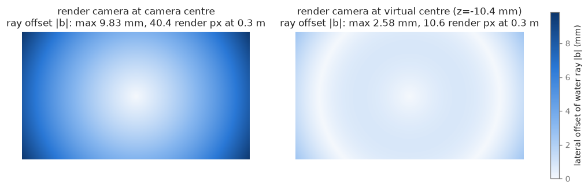
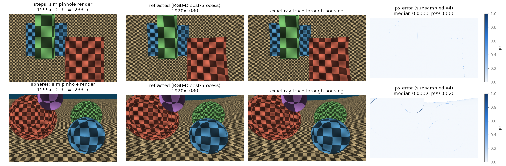
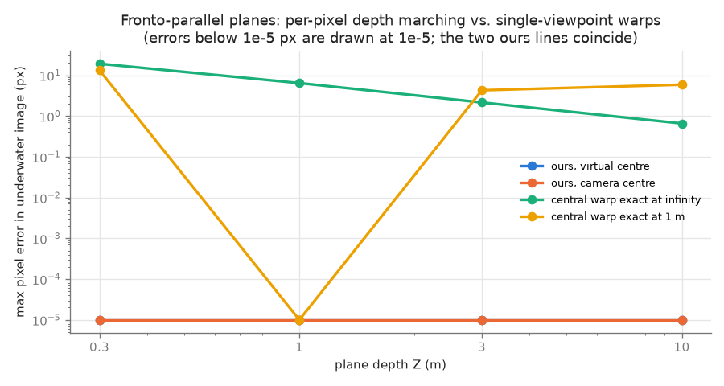
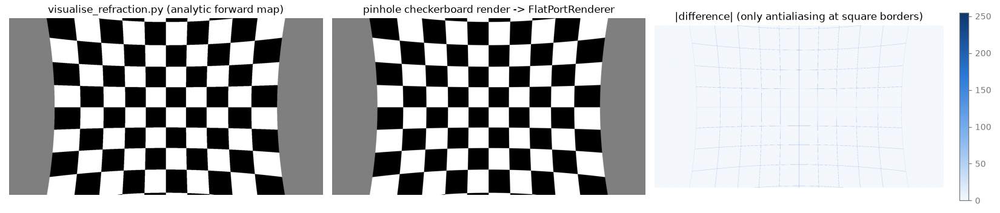
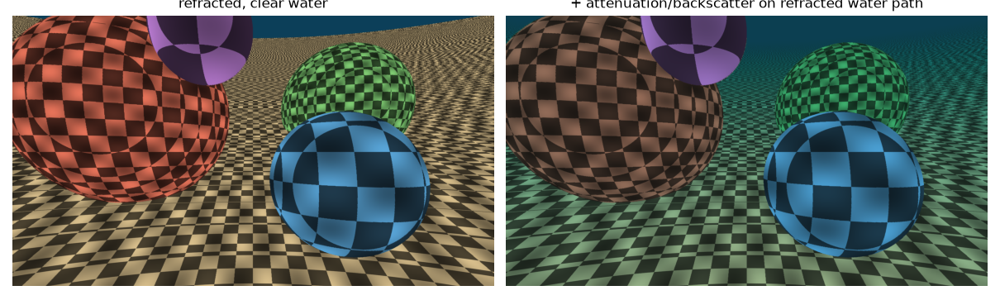

# Exploration: simulating flat-port refraction in underwater simulators

Branch `explore/sim`. This branch adds the inverse of Refrax. It takes a simulator's pinhole
RGB-D render and produces the image that a real camera behind a flat port records.

| Part | Files |
|---|---|
| Core renderer | `core/render.py` |
| Command-line tool | `render_refraction.py` |
| Validation | `sim/validate.py`, `sim/scenes.py`, `sim/figures.py` |
| Simulator adapter | `sim/isaacsim/` |
| Sanity check for simulator output | `sim/check_render.py` |

```bash
pixi run test-sim        # quick validation, exit code != 0 on failure (~15 s)
pixi run validate-sim    # full validation, writes docs/figures/*.png + sim_validation.json (~1 min)
pixi run render-refraction configs/dataset.yaml plan out/           # camera the sim must render
pixi run render-refraction configs/dataset.yaml apply out/          # out/pinhole{,_depth} -> out/underwater{,_depth}
python -m sim.check_render /tmp/demo --make-demo                    # end-to-end with a stand-in "simulator"
```

`pixi.toml` now also lists `osx-arm64`. Everything except the Isaac Sim adapter runs on the M5 Mac.

## 1. Do simulators model flat-port refraction today?

**No.** None of the main robotics simulators renders flat-port refraction natively. Some
other tools do: offline renderers, and one research plugin that applies an optional warp.
The claim should therefore be "no mainstream robotics simulator", not "nobody".

| Simulator | Camera model / hooks | Refraction? | Platform |
|---|---|---|---|
| **HoloOcean 2.3** (UE 5.3) | RGBCamera, DepthCamera (new in 2.3.0), segmentation. Configured only by `FovAngle` + `CaptureWidth/Height`. No lens model and no documented post-process hook. [sensors][ho-s], [changelog][ho-c] | none | Linux/Windows, dedicated GPU; no macOS [install][ho-i] |
| **OceanSim** (Isaac Sim 5.0) | `UW_Camera` reads Replicator `LdrColor` + `distance_to_camera`. A Warp kernel `UW_render` then applies attenuation and backscatter: I = J·e^(−β·d) + B∞(1−e^(−β_b·d)). [paper][os-p], [code][os-c] | none (pinhole) | Isaac Sim (RTX GPU) |
| **Stonefish** | Pinhole colour, depth, thermal, event and segmentation cameras, plus sonars. ROS 2 via `stonefish_ros2`. [sensors][sf-s] | none ("currently does not support flat- or dome-port refraction" [arXiv 2608.26888][sf-x]) | OpenGL 4.3. The README says "MacOS is not supported due to its lack of support for OpenGL 4.3" [README][sf] |
| **Isaac Sim 6.2** | Since 5.0 it uses the OmniLensDistortion schemas: Ftheta, KannalaBrandtK3, RadTanThinPrism, OpenCvPinhole, OpenCvFisheye, **Lut**. Annotators: `rgb`, `distance_to_image_plane`, `distance_to_camera`, `pointcloud`. [camera][is-c], [schemas][is-l], [annotators][is-a] | none. The Lut model holds a per-pixel *direction*, i.e. a central camera; arbitrary per-pixel ray origins do not seem possible (medium confidence) | Ubuntu 22.04/24.04 and Windows x86_64, RTX GPU; no macOS [req][is-r]. `pip install isaacsim[all,extscache]==6.2.0.0 --extra-index-url https://pypi.nvidia.com` with Python 3.12 [pip][is-p]. Not on conda-forge (`pixi search isaacsim`: none), so pixi has to use `pypi-dependencies` on linux-64/win-64 |
| DAVE (Gazebo) | UnderwaterCamera: attenuation + background colour [docs][dave] | none | Linux |
| Song, Köser et al. 2021, UUV-sim plugin | "Optionally, add refraction effect to the image", as a post-process [arXiv][song] | optional warp | Gazebo |
| Sedlazeck & Koch 2011; Seegräber et al. 2024 (Mitsuba) | offline ray tracers with flat and dome ports [VMV][sed], [arXiv][seeg] | yes (offline) | — |

**Running locally.** None of these simulators can run on this Mac:

- **Isaac Sim / OceanSim:** no macOS build and they need an RTX GPU.
- **HoloOcean:** Linux/Windows only.
- **Stonefish:** needs OpenGL 4.3, while macOS stops at 4.1.

So the renderer was validated against exact analytic ray tracing instead (section 3). A stand-in "simulator" (`sim/check_render.py --make-demo`) exercises the same file interface as a real one.

[ho-s]: https://byu-holoocean.github.io/holoocean-docs/v2.3.0/holoocean/sensors.html
[ho-c]: https://byu-holoocean.github.io/holoocean-docs/v2.3.0/changelog/changelog.html
[ho-i]: https://byu-holoocean.github.io/holoocean-docs/v2.3.0/usage/installation.html
[os-p]: https://arxiv.org/html/2503.01074
[os-c]: https://github.com/umfieldrobotics/OceanSim/blob/main/isaacsim/oceansim/sensors/UW_Camera.py
[sf]: https://github.com/patrykcieslak/stonefish
[sf-s]: https://stonefish.readthedocs.io/en/latest/sensors.html
[sf-x]: https://arxiv.org/html/2608.26888
[is-c]: https://docs.isaacsim.omniverse.nvidia.com/latest/sensors/isaacsim_sensors_camera.html
[is-l]: https://docs.omniverse.nvidia.com/kit/docs/omni.usd.schema.omni_lens_distortion/1.0.0/USD_SCHEMAS.html
[is-a]: https://docs.omniverse.nvidia.com/extensions/latest/ext_replicator/annotators_details.html
[is-r]: https://docs.isaacsim.omniverse.nvidia.com/latest/installation/requirements.html
[is-p]: https://docs.isaacsim.omniverse.nvidia.com/latest/installation/install_python.html
[dave]: https://dave-ros2.notion.site/Underwater-Camera-Plugin-5583686b614749b9b0dcd2f8383346e9
[song]: https://arxiv.org/abs/2006.15398
[sed]: https://diglib.eg.org/handle/10.2312/PE.VMV.VMV11.049-056
[seeg]: https://arxiv.org/html/2405.18018

## 2. Design

### A flat port is not a single-viewpoint camera

Each output pixel is traced through the housing using the conventions of `core/optics.py`. Its ray leaves the port at the exit point **P2** along the water ray **d**.

The back-extensions of the water rays do not meet in one point; they form a caustic. With w = 1/Z′ (inverse depth in a render camera at centre **c**), a point on the water ray projects into the render at

    x′/z′ = a + b·w,   a = d_xy/d_z,   b = (P2−c)_xy − (P2−c)_z·a

The projection is therefore a straight **line in w**: the ray's vanishing point plus a parallax term fx·|b|·w. Two consequences:

- A pure 2-D warp, i.e. any central lens model including Isaac Sim's Lut lens, is exact at only one depth.
- With depth, the visible point is the first crossing of the line with the depth map.

### Algorithm (`FlatPortRenderer.trace`)

1. **March** in w from 1/z_near down to 0, in steps of ≤ 0.5 render pixels. At each step, compare the ray's w with the bilinearly interpolated inverse depth of the render. The first crossing is the visible surface, so occlusion works like a z-buffer.
2. **Refine** with Illinois regula falsi. Inverse depth is affine in screen coordinates on a plane, so this is exact for planar patches and converges in one iteration there.
3. **Background:** rays that reach w = 0 without hitting anything take the background colour at their vanishing point.
4. **Outputs:** colour, camera-frame Z per output pixel, water path length |X−P2| (for the attenuation model) and masks (`valid`, `background`, `too_near`, `near_edge`).

The implementation uses NumPy plus `cv2.remap` on the shrinking set of still-active pixels. It takes **≈0.4–0.6 s per 1920×1080 frame** on the M5 CPU. The algorithm is a gather loop, so it ports directly to a Warp/CUDA kernel or to an Unreal post-process material.

### Where to put the render camera: the virtual centre

`virtual_centre` finds the point on the port axis that is closest, in least squares, to all water rays. Paraxially it sits at about d0·(1−μw) behind the camera, plus a glass term. For the GoPro-10 config it is **10.4 mm behind** the real optical centre.

Rendering from the virtual centre instead of the real camera centre:

- reduces the largest lateral ray offset |b| from 9.8 mm to 2.6 mm,
- reduces the march steps from 106 to 27 (3× faster),
- shrinks the disocclusion strips. At depth edges the worst error drops from 10–15 px to 1.2–4 px (spheres and steps scenes).



### Render camera to request from the simulator

`plan_render_camera` / `render_refraction.py plan` returns the render camera. For the GoPro-10 example (z_near = 0.2 m):

- same orientation as the real camera, centre (0, 0, −10.4 mm);
- square pixels with f = oversample·max(fx, fy)·μw/μa = 1233 px, the paraxial magnification;
- centred principal point;
- **1599×1019 px (HFOV 65.9°, VFOV 44.9°)** at oversample 1.

The underwater field of view is smaller than the in-air one (92.4°×60.8°) because refraction narrows it. A render about the size of the output image is therefore enough.

Sampling density: at the image centre one output pixel spans 1.0 render px. At the corners it spans only **0.47 render px** radially, because the flat port magnifies more towards the edges. Use **oversample ≈ 2 (≈3200×2040)** if corners must be as sharp as the centre; 1 is fine for training data where the centre dominates.

The render's near clip plane must sit beyond the housing: the camera is behind the port, so housing and hull meshes must be invisible to it.

### Native alternatives (not chosen)

- **Isaac Sim Lut lens:** a per-pixel-direction table at the virtual centre. It is a central camera, so it is exact at one depth. The "central warp" baselines below measure this: **13–19 px error at 0.3 m**, still 0.65 px at 10 m even when it is exact at infinity.
- **True per-pixel ray origins:** these require a ray tracer with a custom camera, e.g. Mitsuba 3 Python sensors, OptiX, or Warp `mesh_query_ray`. Warp gives exact geometry (depth and IDs), but RTX materials and lighting would have to be re-implemented.

The RGB-D post-process gets essentially exact geometry from any rasteriser or path tracer. It loses only the few disoccluded pixels discussed below.

## 3. Validation

All numbers use the GoPro-10 config, a 1920×1080 output and the virtual-centre render at oversample 1. They come from `docs/figures/sim_validation.json`.

**How the pixel error is measured.** For each output pixel, take the scene point whose colour the renderer shows. Project it back into the underwater camera with an exact refractive projection: Newton iteration, `core.render.project_underwater`. The error is the distance from that projection to the pixel. 40k random pixels are evaluated per scene.

### (a) Exact ray trace through the housing vs. RGB-D post-process

| Scene | p99 err, off edges (px) | max err, off edges (px) | max err incl. edges (px) | pixels > 1 px | flagged near edges | central warp @∞, max (px) | central warp @1 m, max (px) |
|---|---|---|---|---|---|---|---|
| plane 0.3 m | <1e-5 | <1e-5 | <1e-5 | 0 | 0 | 19.2 | 13.3 |
| plane 1 m | <1e-5 | <1e-5 | <1e-5 | 0 | 0 | 6.4 | 0 |
| plane 3 m | <1e-5 | <1e-5 | <1e-5 | 0 | 0 | 2.2 | 4.3 |
| plane 10 m | <1e-5 | <1e-5 | <1e-5 | 0 | 0 | 0.65 | 5.9 |
| plane tilted 50° | 0.0015 | 0.0018 | 0.0018 | 0 | 0 | 9.1 | 5.1 |
| steps (boxes 0.35–1 m, wall 2.5 m) | <1e-4 | 0.007 | 1.22 | 0.005 % | 1.4 % | 3.3 | 3.8 |
| spheres + seabed + open water | 0.004 | 0.010 | 3.97 | 0.07 % | 3.9 % | 7.0 | 5.7 |

Other results:

- **Depth:** away from edges, the depth along the ray has a relative error ≤ 4e-7 on planes.
- **Background:** the background/foreground labels agree with ground truth on 99.97 % of pixels.
- **Edge pixels:** the remaining > 1 px errors sit only on depth edges. There, the render camera, 10 mm away from the true exit points, cannot see what the port sees (disocclusion), or the edge pixel is a bilinear mix.
- **Image error:** PSNR against the point-sampled exact image is 21–37 dB. This measures checker-texture aliasing of point sampling versus bilinear resampling, not geometry.
- **Camera-centre render:** the same accuracy off edges, but up to 10–15 px at edges, and 3× slower.




### (b) Round trip: render → Refrax removal at the true depth → pinhole

The test chain:

1. The renderer creates an underwater image of world-coordinate textures.
2. `remove_refraction.make_map_builder` removes the refraction. It uses zoom 1.423 and the source-size canvas.
3. Each corrected pixel's world point is projected with the corrected pinhole (focal = zoom·f).

| Scene | renderer input: max err (px) | exact-trace input: max err (px) |
|---|---|---|
| planes 0.5 / 1 / 3 m | 0.0026 / 0.0026 / 0.0027 | identical |
| tilted 35° plane, per-pixel depth map | 0.0028 | 0.0027 |
| plane 1 m, raw image with GoPro radtan distortion | 0.0026 | 0.0026 |

The results with the renderer as input and with the exact trace as input are the same. The remaining ~0.003 px therefore comes from Refrax's own inversion: linear `griddata` on a step-4 grid. Rendering followed by removal is the identity to within 0.003 px over the valid region, which is 81–84 % of the frame.

`sim/check_render.py --make-demo` runs the same test photometrically on 8-bit PNGs through the file interface a simulator would use. It gives 33–36 dB PSNR, the residual being two bilinear resamplings.

### (c) Consistency with `visualise_refraction.py`

The checkerboard at z0 = 1 m:

- The world points the renderer shows match the points from Refrax's `forward_map` to **1e-4 mm**. The exact trace matches to 1.4e-4 mm.
- The rendered checkerboard image differs from `visualise_refraction.py`'s image on 0.7 % of pixels, all at anti-aliased square borders.



## 4. Simulator integration

**Isaac Sim (and OceanSim on top of it) was chosen as the integration target:**

- It provides exact z-depth (`distance_to_image_plane`) and arbitrary pinhole intrinsics.
- A camera prim can be mounted at the virtual-centre offset.
- It is pip/pixi-installable on Linux.
- OceanSim already consumes RGB + depth, so refraction slots in just before its water model.

HoloOcean would also work through `FovAngle` = HFOV of the planned camera, square output and the new DepthCamera. Its depth units are undocumented, though, and it offers no intrinsics control.

`sim/isaacsim/render_flatport_isaacsim.py` (**untested**, written against the Replicator and pxr APIs) works as follows:

- It builds a rig in which `/World/FlatPortRig` is the real camera pose and its child `RenderCam` is offset to the virtual centre.
- Intrinsics are set through the aperture: fx = W·focalLength/horizontalAperture.
- It attaches the `rgb` and `distance_to_image_plane` annotators.
- For each frame it calls `FlatPortRenderer.render` and writes `pinhole/`, `pinhole_depth/`, `underwater/`, `underwater_depth/` and `render_camera.yaml`.

`sim/isaacsim/README.md` describes how to add the hook to OceanSim: refract first, then run `UW_render` with `info["water_range"]`. `core.render.apply_water` is the NumPy equivalent of that model.

To run it on a Linux + RTX machine:

```bash
git checkout explore/sim && cd sim/isaacsim
pixi install                                   # separate workspace: isaacsim 6.2.0.0 from pypi.nvidia.com
export OMNI_KIT_ACCEPT_EULA=YES                # only if you accept the NVIDIA EULA
pixi run render -- --config ../../configs/dataset.yaml --frames 20 --out out
cd ../.. && pixi run python -m sim.check_render sim/isaacsim/out   # expect >= 30 dB
```

On the first run, check:

- the printed depth range (`metersPerUnit` handling),
- the demo primitive sizes (whether Replicator primitives are 1 unit or 100 units),
- that the housing and robot meshes are hidden from `RenderCam`.



## 5. Limitations

- **Disocclusion:** an RGB-D image cannot show what the render camera does not see. Errors > 1 px affect 0.005–0.07 % of pixels, all within 1 px of depth edges, and are flagged in `near_edge`. Fixes: extra depth layers, or a second render from the opposite side of the caustic.
- **View-dependent shading** (specular highlights, reflections) is taken from a viewpoint 10 mm away from the true exit points. This is negligible.
- **Resampling is bilinear.** Corners are under-sampled at oversample 1, so use oversample 2 for sharp corners. There is no mip-mapping or anti-aliasing.
- **Dispersion is ignored.** μw varies by about 1 % across the visible range, which gives a flat port lateral chromatic aberration. The renderer can produce it by running one `FlatPortRenderer` per colour channel with a per-channel μw; this was not done.
- **Water effects:** OceanSim applies them at the pinhole range. The correct order is to refract first and then attenuate with `water_range`.
- **Integration code:** the Isaac Sim script has not been executed, and no HoloOcean or Stonefish adapter was written.

## 6. Next steps

1. Run the Isaac Sim adapter on a Linux GPU box, then the OceanSim hook.
2. Render a reef USD trajectory with ground-truth poses. Feed its output to Refrax plus COLMAP/VSLAM, which gives the paper a controlled, simulated version of the real-data experiments.
3. Port `trace` to a Warp kernel: Isaac Sim ships Warp, so the post-process stays on the GPU.
4. Add per-channel μw for dispersion, and a second depth layer for disocclusions.

## 7. Notes on the existing code and paper

- **Depth convention in `remove_refraction.py`:** in depth mode it expects the depth of each *raw underwater pixel* (scene Z, camera frame). Depth estimated on *corrected* images, e.g. MVS on Refrax output, is in the wrong pixel grid. The README should say this. This branch's `underwater_depth/` follows the expected convention.
- **`load_depth` resizes depth with `INTER_LINEAR`.** This blends foreground and background at edges. `INTER_NEAREST` would be safer.
- **Dead code:** `core.optics.trace_underwater` is unused.
- **OpenCV 5.0 (conda-forge, osx-arm64)** lacks `cv2.undistortPointsIter`. The renderer therefore inverts `apply_radtan_distortion` itself.
- **Positive results:** the closed-form inverse map is accurate to 0.003 px, and the depth dependence of the warp is large: up to 19 px at 0.3 m even with the best single centre. This supports the paper's emphasis on using the true depth.
