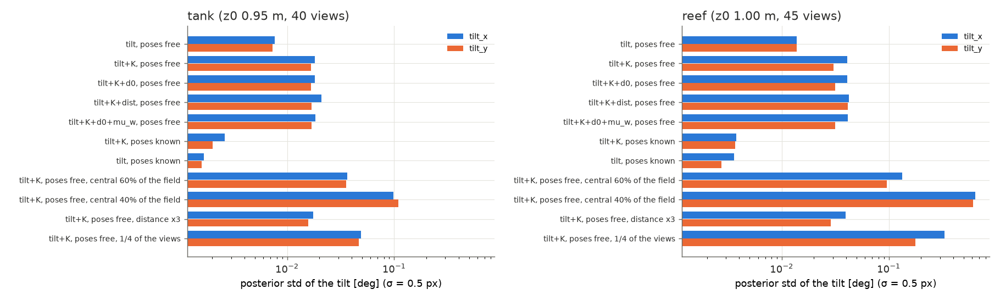
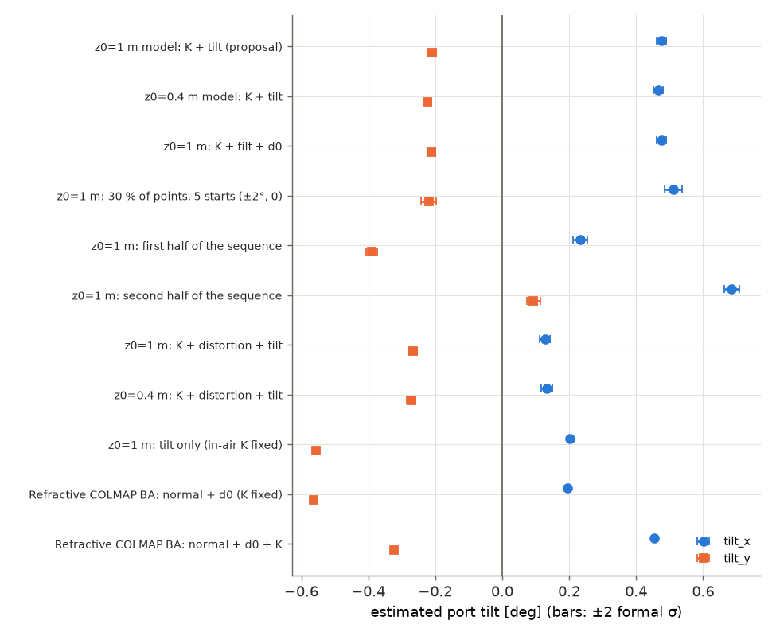

# Exploration: estimating the port tilt in bundle adjustment

Branch `explore/tilt` (on `explore/uncertainty` → `explore/gpu-remove` → `explore/speed`).
Read `docs/explore_uncertainty.md` first: it found that **port tilt** (the port normal
`n_port` deviating from the optical axis) is the only housing parameter that is both large
(0.5° → ~4 px) and not absorbed by refitting the pinhole intrinsics (0.6–1.0 px RMS
non-absorbable per 0.5° at 1 m; 0.3–0.5 px if a constant camera rotation is also allowed).
The PI asked to estimate the two tilt angles (optionally d0) jointly in bundle adjustment
on real data.

Code: `tilt/` (Python prototype), `tests/test_tilt.py`, `configs/flatport/`; C++ in
`colmap-uncertainty` branch `port-tilt` (inner `colmap-src` branch `port-tilt`, commits
`08b3493`, `6e1859b`). Large outputs: `/Users/fischert/robot/refrax-work/tilt/`.

## TL;DR

@@TLDR@@

---

## 1. Prior art

**Upstream COLMAP has no refractive camera models.** The COLMAP 4.2.1 source in
`colmap-uncertainty/colmap-src` (and its pycolmap bindings) contains no flat-/dome-port
model (`grep -ri "refrac\|flatport\|domeport\|underwater"` over the tree finds nothing), and
there is no pull request or issue for it on `colmap/colmap` (GitHub search, 2026-10-15).

**Refractive COLMAP** (She, Seegräber, Nakath, Köser, IROS 2024, arXiv 2403.08640) is a
*fork*: `cau-git.rz.uni-kiel.de/inf-ag-koeser/colmap_underwater` (mirror
`github.com/MDSKiel/colmap_underwater`), based on COLMAP 3.10-dev, last commit 2024-10-29,
never upstreamed. What it does (read from `src/colmap/sensor/models_refrac.h`,
`estimators/cost_functions.h`, `estimators/bundle_adjustment.cc`):

* `FLATPORT` refractive model with parameters `Nx, Ny, Nz, int_dist, int_thick, na, ng, nw`
  layered on any in-air camera model (and `DOMEPORT`). The whole SfM pipeline is refractive:
  generalised relative pose, refractive triangulation / absolute pose (virtual cameras).
* BA residual: per keypoint a *virtual pinhole camera* on the refraction axis; the residual
  is the pinhole reprojection error on that virtual image plane (focal = in-air fx), i.e. an
  angular error of the water ray scaled by fx. The forward projection (`ImgFromCam`) needs
  100 Newton iterations with numeric derivatives and is not used in BA.
* `refine_refrac_params` refines the port normal (sphere manifold) **and** `int_dist` (d0)
  together — tilt and d0 cannot be refined separately; the mapper can fix them until N
  images are registered.

**The Refrax paper already compares against it** (arXiv 2610.07788, Sec. IV–V, Lizard
Island / Malaysia table): full joint refractive SfM does not consistently beat plain COLMAP
— κ ∈ [+0.10, +0.69] on Malaysia, two failed reconstructions, dome artefacts — which the
paper attributes to over-parameterisation hindering convergence (local minima). So Refractive
COLMAP is a cautionary baseline, not the solution: what is needed is a **minimal,
well-conditioned refinement** — only θx, θy (optionally d0) on top of Refrax's image-space
correction, with the rest of SfM unchanged.

**What we used it for:** an independent cross-check of the tilt estimate. I built the fork
with the colmap-uncertainty toolchain (two trivial compile fixes for Boost 1.90 /
clang: `refrax-work/tilt/kiel_build.patch`, plus exposing `BundleAdjustment.enable_refraction`
/ `refine_refrac_params` on the `bundle_adjuster` CLI) and ran **only its bundle adjuster**
on exactly our observations (raw keypoints, metric poses/points, `tilt/kiel_export.py`), not
its mapper. Its estimate agrees with ours (§4b).

Older related work (camera-side calibration of the interface normal from a target or in
BA): Treibitz et al. (PAMI 2012), Agrawal et al. (CVPR 2012, axial camera, multi-layer flat
refraction with normal estimation), Jordt-Sedlazeck & Koch (ICCV 2013, refractive SfM with
interface estimation), Chadebecq et al. (ICCV 2017, refractive two-view geometry). None is
available as a maintained COLMAP component.

**Decision:** do not duplicate a refractive SfM. Keep Refrax's pinhole pipeline (feature
matching, registration and triangulation on corrected images) and add a refractive *BA* term
with 2–3 extra global parameters. This is (a) a Python prototype with an exact Schur-LM and
posterior covariance, and (b) a C++ cost in the patched COLMAP that `bundle_adjuster`,
pycolmap and the incremental mapper's local/global BAs can use.

## 2. Formulation

**Parameters.** In-air intrinsics (fx, fy, cx, cy; radtan k1, k2, p1, p2 optional), port tilt
θx, θy (n_port = Rᵀe_z with R = Rx(θx) Ry(θy), i.e. n ≈ (−θy, θx, 1), the convention of
`core/uncertainty.py`), optionally d0. Fixed: μ_a, μ_g, μ_w, tglass (the uncertainty study
showed glass is irrelevant and μ_w is a pure zoom, absorbed by fx). Per image a pose, per
track a 3-D point.

**Observations: raw keypoints.** The SfM model is built on Refrax-corrected images (fixed
depth z0, nominal housing). Every corrected keypoint q maps back *exactly* to the raw image:
solve c + f F(p, 1/z0) = q for the in-air normalised ray p (2-D Newton on the closed-form
model of `core/flatport.py`), then apply the in-air lens (`tilt.model.raw_from_corrected`;
C++ `FlatPortBundleAdjustmentOptions::RawFromKeypoint`). No re-extraction is needed and the
matches/tracks stay valid. (Depth-map mode would need the per-pixel depth for this step.)

**Residual: back-projection form, closed form.** The 3-D point gives the depth exactly. For
P = R X + t (metric: × the scale in metres per model unit):

    w     = 1 / P_z
    F(u)  = A(p(u)) + B(p(u)) · w          (water ray of the raw keypoint at depth P_z)
    e     = P_xy / P_z − F(u)               (= 0 iff the refracted ray passes through P)
    r     = J_u⁻¹ e,   J_u = ∂F/∂u (2×2)     (≈ raw-pixel units, isotropic for raw noise)

`A, B` are the affine-in-inverse-depth flat-port coefficients of `core/flatport.py` (tilted
case). The forward direction (point → raw pixel) would need the iterative/quartic flat-port
forward solve inside every residual and Jacobian evaluation (Refractive COLMAP's
`ImgFromCam` does 100 numeric-derivative Newton steps); the back-projection form needs one
closed-form refraction plus the in-air undistortion (8 Newton steps). `J_u` is evaluated at
the current estimate and held fixed in the derivative (its derivative multiplies e, so it is
second order at the solution); the C++ unit test confirms the Jacobians against numeric
differentiation at the solution, and the 1-px test confirms the raw-pixel scaling.

**Jacobians.** Python: one batched forward-mode AD pass (`torch.func.jvp`, vmapped over the
14 + 3 tangent directions: θ, w, u, v), chained with the pose/point derivatives. C++:
Ceres autodiff (`FlatPortReprojErrorCostFunctor<CameraModel>`), with the undistortion done
in double and one Newton correction in the Jet type (exact first derivatives by the
implicit-function theorem, valid for every COLMAP camera model).

**Solver (Python, `tilt/ba.py`).** Levenberg–Marquardt with the points eliminated (3×3
blocks, Schur complement); the reduced system over poses + globals is dense (6·n_img + k ≈
770) and solved directly, which also gives the **posterior covariance** of the globals
(points marginalised). Huber loss (2 px), IRLS. Gauge: camera 0 fixed; the **metric scale is
held fixed** (one translation coordinate) — refraction makes it weakly observable (d0, tglass
are metric), but explore/depth found self-calibrating it is coarse; the gopro10 scale is
explore/depth's 0.11347 m/unit (median depth 1.02 m), Lizard's is the GPS scale. The
globals are gauge-invariant, so their marginal covariance does not depend on the gauge
choice. Cost: ~18 s per LM iteration for 596k observations on 2 CPU threads.

## 3. Identifiability

**Why a tilt is mostly absorbable.** Paraxially, a flat port scales the ray tangent in the
port frame by k = μ_a/μ_w. Tilting the port by δ rotates the ray into the port frame,
scales, and rotates back: to first order this is the on-axis map plus a **constant image
shift (1 − k)·f·δ ≈ 0.25 f δ** (≈ 3–4 px per 0.5° on gopro10, the cx/cy shift of the
uncertainty study), i.e. exactly a principal-point shift, which for a pinhole is also a
small constant camera rotation. What is left — and what makes the tilt observable — is

1. the **non-paraxial** part: k depends on the field angle (k = r/√(1 + (1 − r²)ρ²)), so the
   tilt-induced shift varies across the image like a decentering distortion. It grows
   steeply with the field of view and does **not** fade with distance;
2. the **depth-dependent** part through B·w (the ray's lateral offset at the port, ∝ d0/Z):
   a tilt moves it differently at different depths. It fades as d0/Z.

So tilt competes with (cx, cy), with a constant rotation of every pose, and with tangential
distortion (p1, p2), and the FOV is what separates them.

**Fisher information** (`tilt/identifiability.py`, `docs/figures/tilt_identifiability.{json,png}`):
posterior σ of θx/θy for σ_px = 0.5 at the true state of the synthetic tank / reef scenes,
points marginalised, gauge fixed.

| configuration | tank σ θx / θy [°] | reef σ θx / θy [°] | strongest correlations |
| --- | --- | --- | --- |
| tilt only, poses free | 0.008 / 0.007 | 0.014 / 0.014 | — |
| **tilt + in-air K, poses free** (the proposal) | **0.018 / 0.017** | **0.041 / 0.030** | θx–cy −0.91 / −0.94, θy–cx +0.90 / +0.87 |
| + d0 | 0.018 / 0.017 | 0.041 / 0.032 | d0–θy 0.29 (reef) |
| + d0 + μ_w | 0.018 / 0.017 | 0.041 / 0.032 | — |
| + distortion k1, k2, p1, p2 | 0.021 / 0.017 | 0.042 / 0.041 | θx–p1 0.49 (tank), θy–p2 0.66 (reef) |
| tilt + K, **poses known** | 0.003 / 0.002 | 0.004 / 0.004 | θx–cy 0.77 / 0.29 |
| tilt + K, central 60 % of the field | 0.037 / 0.036 | 0.13 / 0.10 | θ–c ≥ 0.9 |
| tilt + K, central 40 % of the field | 0.10 / 0.11 | 0.64 / 0.61 | θ–c 0.9–0.98 |
| tilt + K, scene 3× farther | 0.018 / 0.016 | 0.039 / 0.029 | unchanged |
| tilt + K, 1/4 of the views | 0.049 / 0.047 | 0.33 / 0.18 | |

Reading:

* **Freeing the camera poses costs 5–10× in σ** (poses known 0.002–0.004° → free
  0.018–0.041°): this is the constant-rotation confound. It is not a degeneracy — the
  tilt stays observable to a few hundredths of a degree with typical data — but a rig with
  fixed, calibrated extrinsics or an IMU/gravity prior would pin it down much better.
* **The principal point is the main partner** (|corr| 0.87–0.94). Estimating the tilt
  with in-air K fixed is better conditioned only if the in-air (cx, cy) are right; on real
  data they are not exactly (see §4b), so fixing K moves the tilt estimate.
* **Field of view is the lever; distance is not.** Restricting to the central 40 % of the
  image makes the tilt 5–15× worse (reef: 0.6°, i.e. useless), while a 3× more distant scene
  changes nothing: the useful signal is the non-paraxial term, not the d0/Z term.
  Consequence: GoPro-class wide FOV is favourable; a narrow lens behind a flat port cannot
  estimate its tilt and does not need to (the effect is then absorbed).
* **d0 and μ_w do not degrade the tilt** (they are zoom-like), but d0 itself is weakly
  determined and correlated with the focal length / scale; distortion competes (p1/p2
  correlations 0.5–0.66) — on real data this is where the systematic error comes from.
* Few views (1/4) hurt more on the reef survey (parallel, nadir views: little rotation
  diversity) than on the hand-held tank (varied orientations).

## 4. Results

### 4a. Synthetic

`tilt/synthetic.py` (`docs/figures/tilt_synthetic.json`, `tilt_synthetic.png`). Scenes of
`uncertainty/synthetic_ba.py`: **tank** (1.2 m planar board, 40 hand-held views at
0.7–1.3 m) and **reef** (3.2 m terrain with ±0.35 m relief, 45-view lawn-mower survey at
1.1 m). Per trial all housing / lens parameters are drawn from the uncertainty prior (d0 ±2
mm, μ_w ±0.0034, μ_g, tglass, in-air K ±1–1.5 px, distortion), the tilt is set to 0, 0.5,
1 or 2° in a random direction; raw keypoints exact + 0.5 px noise; 5 trials per tilt and
scene; all methods start from the same perturbed poses/points; metric scale held. Methods:
*Refrax + pinhole BA* (today: nominal correction at fixed z0, PINHOLE K refined),
*refractive BA without tilt* (raw keypoints, exact depth, in-air K refined), *refractive BA
+ tilt*, *+ d0*, *Refrax with the estimated tilt + pinhole BA* (the two-stage route: estimate
once, re-correct, ordinary SfM), *oracle* (all true parameters).

**Tilt recovery** (refractive BA + tilt, in-air K free): RMS error 0.02–0.09° per axis at
every tilt magnitude (tank 0.02–0.09°, reef 0.03–0.07°), against a formal posterior σ of
0.019° (tank). The formal σ is too small by 1.5–3× (NEES 3.5–27 instead of 2): the
remaining error is bias from the *other* mis-specified parameters (μ_w, glass, distortion
drawn from the prior but held at nominal), not noise. Realistic accuracy: **≈0.05°**.

Median 3-D point error [mm] (`pos` = camera centres, after Sim3 alignment):

| tilt | Refrax + pinhole BA | Refrax(est. tilt) + pinhole | refr. BA, no tilt | **refr. BA + tilt** | + d0 | oracle |
| --- | --- | --- | --- | --- | --- | --- |
| tank 0° | 4.41 | 4.42 | 1.17 | 1.17 | 0.84 | 0.40 |
| tank 0.5° | 4.89 | 4.76 | 2.29 | 2.25 | 1.11 | 0.39 |
| tank 1° | 4.18 | 4.07 | 2.23 | 1.98 | 1.34 | 0.42 |
| tank 2° | 5.89 | 5.05 | 2.68 | 1.68 | 0.78 | 0.41 |
| reef 0° | 12.3 | 12.6 | 5.8 | 6.0 | 7.0 | 2.8 |
| reef 0.5° | 20.8 | 16.8 | 8.3 | 7.0 | 7.3 | 2.4 |
| reef 1° | 22.1 | 10.5 | 13.0 | 4.7 | 8.4 | 2.7 |
| reef 2° | 42.7 | 12.1 | 24.7 | 7.2 | 7.8 | 3.0 |

Board planarity (tank) is 0.018–0.022 % for every method — a planar board is a weak
metric for these errors (they are mostly a smooth bending + scale/shape of the trajectory).

Reading:

* **Tilt matters for 3-D scenes, and grows with the tilt.** On the reef the pipeline error
  grows 12 → 43 mm from 0° to 2°; estimating the tilt keeps it flat (5–7 mm). The rotation
  error with a constant rotation removed (`rot_rel`) shows the same (reef 2°: 0.81° → 0.20°).
* **Most of the benefit on the tank is not the tilt but the exact depth** (fixed-z0 Refrax
  4.4 mm → refractive BA 1.2 mm at 0° tilt): the board spans 0.7–1.3 m. The tilt adds a
  further factor up to 1.6 at 2°.
* **Two-stage (estimate once, re-correct, ordinary pinhole SfM)** recovers about half of
  the tilt-induced error on the reef (1°: 22 → 10.5 mm; 2°: 43 → 12 mm) but none of the
  fixed-depth error, as expected. It is the low-risk route: SfM itself is unchanged.
* **d0** helps the tank but not the reef; it is weakly identified (it trades with the focal
  length and the metric scale) — keep it fixed unless the scene is close and has strong
  depth range.
* At 0° tilt, freeing the tilt costs nothing (tank 1.17 = 1.17 mm; reef 5.8 → 6.0).

### 4b. gopro10 tank

**Data.** explore/depth's stock-mapper models of the 128 Refrax-corrected gopro10 frames
(fixed depth z0 = 1 m and, independently re-extracted and re-mapped, z0 = 0.4 m;
`refrax-work/uncertainty/gopro10_z*/ba/0_input`), 596k observations, 42.9k points; keypoints
mapped back to the raw frames; metric scale from explore/depth (0.11347 / 0.10724 m per unit,
median depth 1.02 / 0.97 m); Huber 2 px; σ scaled by the a-posteriori residual variance
(σ̂ ≈ 0.58 px). Board planarity: AprilGrid points selected as in explore/uncertainty
(relative plane-fit RMSE / quadric curvature κ). `tilt/real.py`, outputs in
`refrax-work/tilt/gopro10_z1/`, `gopro10_z0.4/`, logs in `refrax-work/tilt/logs/`.

| run | θx [°] | θy [°] | in-air cx, cy after BA | robust σ̂ [px] | board RMSE % / κ |
| --- | --- | --- | --- | --- | --- |
| input model (Refrax + stock mapper, PINHOLE fixed) | – | – | (959.3, 544.9 nominal) | – | 0.162 / −0.0031 |
| refractive BA, K only (no tilt) | 0 | 0 | 963.4, 546.0 | 0.579 | 0.151 / −0.0020 |
| **refractive BA, K + tilt** | **+0.476 ± 0.007** | **−0.209 ± 0.006** | 962.2, 542.9 | 0.577 | 0.152 / −0.0020 |
| K + tilt + d0 (d0 = 20.2 ± 0.1 mm) | +0.475 | −0.212 | 962.2, 543.0 | 0.577 | 0.152 / −0.0021 |
| same, z0 = 0.4 m model (independent features) | +0.466 | −0.223 | 962.1, 543.0 | 0.577 | 0.155 / +0.0026 |
| 30 % of the points, 5 starts at (±2°, ±2°), (0, 0) | +0.511 (all 5 identical to 1e-4°) | −0.219 | 962.0, 542.7 | – | – |
| first half of the sequence (64 frames) | +0.233 ± 0.011 | −0.390 ± 0.009 | 961.4, 545.0 | 0.573 | – |
| second half | +0.685 ± 0.011 | +0.093 ± 0.010 | 963.6, 541.4 | 0.561 | – |
| K + distortion (k1, k2, p1, p2) + tilt | +0.128 | −0.267 | 958.8, 542.2 | 0.554 | 0.149 / −0.0060 |
| same, z0 = 0.4 m model | +0.133 | −0.272 | 958.7, 542.5 | 0.556 | 0.154 / +0.0066 |
| K + distortion, no tilt | 0 | 0 | 960.7, 542.2 | 0.554 | 0.148 / −0.0058 |
| tilt only, in-air K fixed at the calibration | +0.203 | −0.556 | (fixed) | 0.581 | 0.154 / +0.0016 |
| Refractive COLMAP BA (fork), normal + d0, K fixed | +0.194 | −0.563 | (fixed) | – | – |
| Refractive COLMAP BA (fork), normal + d0 + K | +0.455 | −0.323 | 961.9, 543.6 | – | – (d0 → 29 mm) |

(± = formal posterior σ.)

Reading:

* **Estimated tilt: θx ≈ +0.3 … +0.5°, θy ≈ −0.2 … −0.4°, |tilt| ≈ 0.5°**, i.e. exactly
  the size the uncertainty study assumed as 1σ. The *formal* σ (0.006–0.007°) is
  meaningless as an accuracy: the estimate moves by up to 0.45° between the two halves of
  the sequence and by 0.35° when the in-air distortion is freed. A realistic uncertainty is
  **±0.2–0.3° per axis**. Repeatability for the *same* modelling choices is excellent
  (z0 = 1 m vs 0.4 m models, i.e. different features and matches: 0.01°; all five starts of
  the multi-start converge to the same point — no local minima, unlike full refractive SfM).
* **Independent implementation agrees.** Refractive COLMAP's bundle adjuster on the same
  observations gives the same answer for the same parameterisation (K fixed: 0.194 / −0.563
  vs ours 0.203 / −0.556; with K: θx 0.455 vs 0.475, θy differs by 0.1° — it also frees d0,
  which it drives to 29 mm, and weights residuals differently).
* **What the data cannot separate** (cf. §3): tilt ↔ in-air principal point (cy moves 3 px
  when the tilt is added) ↔ tangential distortion (p1, p2) ↔ which views are used. The
  GoPro "Linear" mode is a digitally dewarped image; its in-air radtan calibration
  (p1 = 1.7e-3, relatively large) is itself uncertain at this level. Hence the tilt is
  only determined to the extent the in-air lens model is right.
* **It explains the principal-point drift of the pinhole pipeline.** Refining the PINHOLE
  intrinsics of the corrected model moves cx by +10 px and cy by +2.4 px (explore/
  uncertainty). After re-correcting with the estimated tilt + in-air K (below), the pinhole
  BA's principal point stays at the declared one (848.4 / 483.8 vs 849.3 / 483.9).
* **It does not improve this reconstruction.** Board planarity is 0.151 % (K only) vs 0.152 %
  (K + tilt); the improvement from the input model (0.162 %) comes from the refractive BA's
  exact per-point depth and refined in-air K, not from the tilt. The planar board 0.7–1.3 m
  away is insensitive to a 0.5° tilt (synthetic §4a: tank planarity 0.018–0.022 % for every
  method).

**Feeding the tilt back into Refrax (two-stage).** `tilt/feedback.py`: every keypoint is
re-corrected exactly as remove_refraction.py would with the new `n_port` (and in-air K),
then a stock COLMAP global BA (PINHOLE f, c refined) — `refrax-work/tilt/gopro10_z1/feedback/`:

| correction | pinhole BA reproj RMS [px] | board RMSE % / κ | refined c (declared 849.3, 483.9) |
| --- | --- | --- | --- |
| nominal (today) | 0.782 | 0.1553 / −0.0027 | 859.1, 486.2 |
| est. tilt | 0.778 | 0.1553 / −0.0029 | 856.0, 478.7 |
| est. tilt + in-air K | 0.780 | 0.1549 / −0.0028 | 848.4, 483.8 |
| est. in-air K only | 0.781 | 0.1556 / −0.0027 | 848.1, 482.7 |

Consistent, but no measurable gain on this scene: the reprojection error drops by 0.5 % and
planarity is unchanged within the ±0.01 % run-to-run spread of explore/uncertainty.

### 4c. Lizard Island

@@LIZ@@

## 5. Implementation in COLMAP (colmap-uncertainty, branch `port-tilt`)

Branch `port-tilt` of `/Users/fischert/robot/colmap-uncertainty` (outer repo) and of its
`colmap-src` (inner, on top of the covariance patch `uncertainty`). Not pushed; `pixi run
export-patch` would turn it into `patches/0002-*.patch`.

* `estimators/cost_functions/flatport.h`: `FlatPortReprojErrorCostFunctor<CameraModel>`
  (blocks point3D 3, cam_from_world 7, in-air camera params, housing 3 = θx, θy, d0) and a
  constant-pose variant; `depth_scale` (metres per model unit) as a constant;
  `FlatPortImgFromCam` (forward projection by Newton, for simulation/tests). Templated on the
  in-air camera model (any COLMAP model), factory by `CameraModelId`.
* `estimators/flatport_options.{h,cc}`: `FlatPortBundleAdjustmentOptions` — how keypoints map
  back to the raw image (declared corrected pinhole, keypoint offset −0.5, z0, nominal in-air
  camera and housing), metric scale (given, or per BA "median observation depth = z0"), what
  to refine (tilt, d0, in-air focal / principal point / distortion), `min_num_reg_images`
  before the globals are freed, `update_declared_camera`, and a **shared state** (in-air
  params, housing, raw-keypoint cache) that persists across all BAs of a mapper run; text
  config reader (`configs/flatport/gopro10_z1.txt`) and state writer.
* `DefaultBundleAdjuster`: with `BundleAdjustmentOptions::flatport` set, every reprojection
  residual of a single-camera frame is replaced by the flat-port residual of the raw
  keypoint; the reconstruction's own (declared pinhole) camera is not in the problem; after
  the solve the declared pinhole is refitted to the corrected keypoints by linear least
  squares, so the pinhole parts of the mapper (registration, triangulation, outlier filters)
  absorb the change of the housing estimate (the hybrid stays consistent: corrected
  keypoints + pinhole everywhere except in BA). Multi-camera rigs throw (not supported).
* CLI: `colmap bundle_adjuster --flatport_config FILE` and `colmap mapper --flatport_config
  FILE` (local and global BAs). pycolmap: `FlatPortBundleAdjustmentOptions`,
  `FlatPortState`, `FlatPortConstants`, `read_flatport_options`,
  `BundleAdjustmentOptions.flatport`, `IncrementalPipelineOptions.ba_flatport`,
  `cost_functions.FlatPortReprojErrorCost` (for pyceres problems).
* Tests: `flatport_test` (5: on-axis model = closed form, Snell's law and tilt convention,
  zero residual + 1-px scaling, autodiff vs numeric Jacobians, Ceres BA recovers a
  (0.6°, −1.1°) tilt to < 0.001°) and `flatport_ba_test` (2: RawFromKeypoint inverts the
  Refrax correction to 1e-8 px; DefaultBundleAdjuster with flat-port options recovers
  (0.8°, −1.3°) from corrected keypoints of a synthetic dataset, and stock BA cannot fit it).

@@CPPRES@@

## 6. Recommendations and next steps

@@REC@@

## 7. Reproduce

@@REPRO@@
