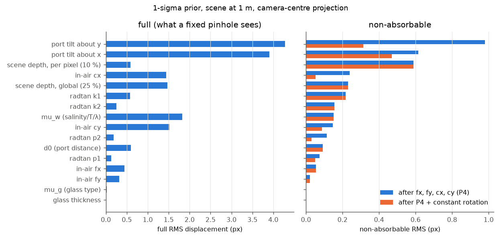
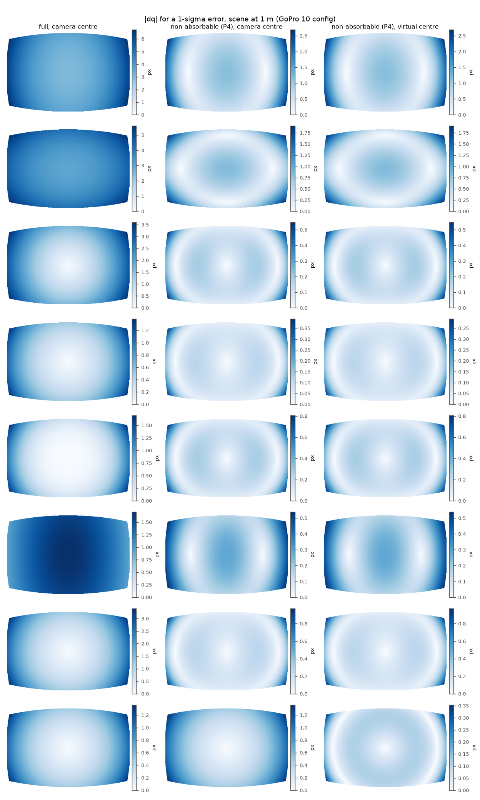
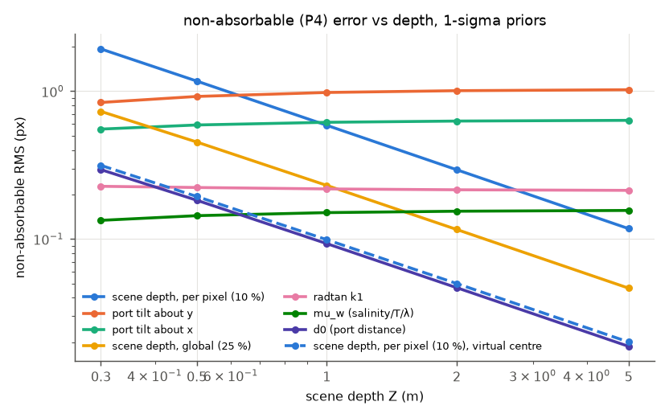
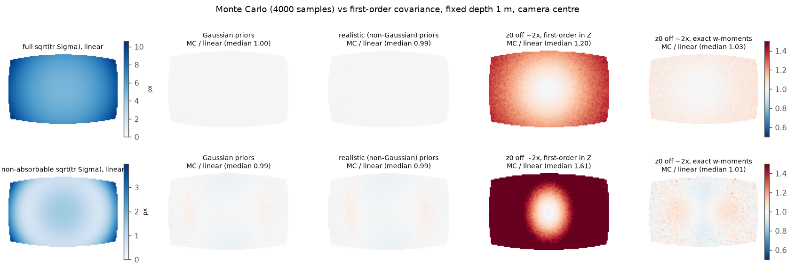
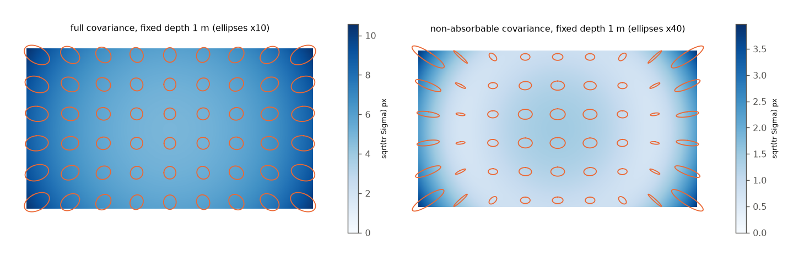

# Exploration: how much do unknown housing parameters matter? Per-pixel uncertainty for SfM / SLAM

Branch `explore/uncertainty`, built on `explore/gpu-remove` (on `explore/speed`). Read
`docs/explore_speed.md` (closed-form model `F(p, w) = A(p) + B(p)·w`, `w = 1/Z`) and
`../Refrax-depth/docs/explore_depth.md` (virtual centre, absorbable vs non-pinhole error)
first.

The PI's question: *"We'll never know the exact lens thickness, depth, etc. How much does that
impact the refraction?"*

## TL;DR

1. **What a wrong parameter does to the corrected image.** Errors are given in output px,
   per 1σ of a realistic prior, with the scene at 1 m and the GoPro 10 config. Most of each
   error is a change of focal length or principal point, which SfM absorbs when it refines
   the intrinsics. The column that matters is the non-absorbable part:

   | parameter (1σ) | full RMS / max | **non-absorbable RMS / max** | absorbed as |
   | --- | --- | --- | --- |
   | port tilt about y (0.5°) | 4.28 / 6.74 | **0.98 / 2.70** (0.31 with a constant rotation) | cx −4.2 px |
   | port tilt about x (0.5°) | 3.91 / 5.60 | **0.62 / 1.90** (0.47) | cy +3.9 px |
   | scene depth per pixel (10 %, fixed-depth mode) | 0.59 / 1.36 | **0.59 / 1.36** (0.10 / 0.32 at the virtual centre) | nothing |
   | in-air cx (1.5 px) | 1.44 / 1.70 | **0.24 / 0.54** (0.05) | cx |
   | scene depth global (z0 ±25 %) | 1.47 / 3.41 | **0.23 / 0.97** | f +3.5 px |
   | radtan k1 (2e-3) | 0.58 / 1.70 | **0.22 / 0.81** | f −1.4 px |
   | μ_w (σ 0.0034: S 0–40 PSU, T 0–30 °C, λ 450–650 nm) | 1.83 / 3.59 | **0.15 / 0.55** | f −4.4 px |
   | d0 (2 mm) | 0.60 / 1.39 | **0.09 / 0.39** | f +1.4 px |
   | in-air fx, fy (1 px) | 0.44 / 0.68 | 0.05 / 0.15 | f |
   | glass index (0.03), glass thickness (0.2 mm) | ≤ 0.03 | **≤ 0.005** | — |

   * **Glass thickness and glass type do not matter** (< 0.01 px), so they are not worth
     measuring.
   * **d0 and μ_w are almost entirely a zoom** (85–92 % of their RMS is absorbed). d0's effect scales as 1/Z.
     μ_w's effect does not depend on depth.
   * **The non-absorbable error is dominated by port tilt and by depth.** Tilt is a
     manufacturing and seating unknown, and it is the one parameter that cannot be
     absorbed. Depth means per-pixel depth error (relief around z0 in fixed-depth mode) and,
     at < 0.5 m, a wrong z0.
   * The in-air intrinsics error comes through refraction mostly absorbable. Its remainder
     (cx: 0.24 px; k1: 0.22 px) is about what the same error would cost in air.
   * Dispersion: R and B differ by Δμ_w ≈ 0.0056. That gives each colour channel its own
     magnification: 3.0 px RMS (5.9 px max) of lateral colour between R and B in the
     corrected image, of which 0.25 px is non-absorbable.
2. **First-order covariance propagation is accurate.** Torch autodiff and the closed-form
   Jacobians agree to 1e-12, and both agree with finite differences to 1e-8.
   * **Monte Carlo** (4000 samples): per-pixel sqrt(trace) ratio MC/linear is 0.99–1.00
     (range 0.96–1.04 non-absorbable). NEES is 1.98, with 95.2 % of samples inside the 95 %
     ellipse. This holds even with 3σ priors or non-Gaussian priors (uniform salinity,
     temperature, wavelength and glass type).
   * **Where it breaks: z0 uncertain by ~2x.** The first-order propagation in Z then
     underestimates by 1.2x (full) and 1.6x (non-absorbable).
   * **The fix is exact:** the model is affine in inverse depth, so the depth term uses the
     exact log-normal moment of w (`w_rms`). The ratio is then back to 1.03 / 1.01.
   * There is no TIR for an air→glass→water flat port (sin θ_w = sin θ_a/μ_w < 1).
3. **Per-pixel covariance maps.** `pixi run -e gpu refraction-uncertainty <config>` writes the
   agreed format: `<cov_dir>/<stem>.npy` or `shared.npy`, float32 (H, W, 3) =
   (σxx, σxy, σyy) px², on the corrected and cropped grid. It writes both the
   non-absorbable (`cov/`) and the full (`cov_full/`) covariance.
   * For the gopro10 fixed-depth map at 1 m, sqrt(trace) is **6.0 px full / 1.1 px
     non-absorbable**, median, up to 10.6 / 3.9 px in the corners.
   * **Per-frame maps** (depth-map mode) use the affine-in-w structure: each pixel's
     covariance is a quadratic in w with precomputed coefficients. A frame costs ~33 ms on
     the M5 GPU for 1.9 Mpx, after a one-off ~20 s set-up.
   * Against the exact per-frame Jacobians the error is ≤ 0.2 % (full) / 0.7 %
     (non-absorbable). Monte Carlo on a real depth frame gives a median ratio of 1.000 and
     NEES 2.00.
4. **Downstream: weighting helps a little; estimating tilt helps a lot.**
   * **Synthetic BA** (tank board / 3-D reef; true parameters drawn from the prior;
     corrected with nominal values; 8 trials each). Weighting with the non-absorbable
     covariance (+ (0.5 px)² keypoint noise) lowers camera-position and 3-D point error by
     **6–9 %**, and won in 7–8 of 8 trials. The full covariance gains less (4–7 %).
   * **Correcting with the true parameters** (oracle) halves the 3-D error. A refractive
     BA that estimates d0, μ_w and the two tilts from the raw observations does better still:
     point error 4.1 → 0.7 mm (tank) and 17.8 → 4.3 mm (reef).
   * **What that refractive BA recovers:** tilt to 0.07–0.13°, against a 0.5° prior. d0
     and μ_w are not identifiable, but they do not need to be.
   * **Real gopro10** (pycolmap global BA from explore/depth's models): weighted and
     unweighted BA are indistinguishable. Board planarity is 0.152–0.167 % against
     0.155–0.162 %, and |κ| ≤ 0.0034 in all variants. On this scene the systematic errors
     are absorbed, and the 1.9 px corner-noise floor (explore/depth) dominates. The patched
     COLMAP mapper results are in §5.3.

**Recommendations.**
1. **Calibrate (or estimate) the port tilt.** Measure it in water once per housing and
   camera seating, or add the two tilt angles as camera parameters in a refractive BA. It
   is the only parameter that is both large and non-absorbable.
2. **Always let SfM/SLAM refine fx, fy, cx, cy** (or at least zoom and principal point).
   That absorbs d0, μ_w, the global depth and most intrinsics errors. If intrinsics must
   stay fixed (multi-camera rigs with fixed calibration), use the full covariance or, better,
   fix μ_w and z0 properly.
3. **Get z0 within ~25 % and use the virtual centre for per-pixel depth.** The virtual
   centre cuts the non-absorbable per-pixel depth term 6x (0.59 → 0.10 px at 1 m).
4. **Feed SfM the *non-absorbable* covariance plus keypoint noise**, and treat it as a
   weighting heuristic, not as a noise model. Its dominant terms are correlated across all
   pixels and images: a tilt error is the same in every frame. BA will be overconfident if
   these are treated as independent noise. They do not average out, and they bias rather
   than scatter. The honest treatment of the large systematic terms (tilt, z0) is to
   estimate them: as extra BA parameters, or by calibration. Per-pixel inflation is right
   only for genuinely per-pixel terms (depth-map noise, scene relief in fixed-depth mode).
5. Glass thickness and glass type: use the nominal values. Salinity, temperature and
   colour: use a sensible μ_w, for example fresh water vs sea. The config's 1.34 is
   seawater at green; the tank is likely fresh water, 1.335 ± 0.002. That is ~1.4σ, mostly
   zoom.

---

## 1. Parameter priors

`core/uncertainty.py: default_prior()` holds the priors. Override them per config with
`uncertainty:` (`d0`, `tglass` in m; `mu_g`, `mu_w`; `tilt_deg`; `fx`, `fy`, `cx`, `cy` in
px; `k1`..`p2`; `depth_global`, `depth_local`) or with `--set key=value`. All values are 1σ,
**assumptions until the PI supplies housing tolerances**:

| parameter | nominal | 1σ | source / assumption |
| --- | --- | --- | --- |
| d0 (camera centre → inner port) | 20 mm | 2 mm | The entrance-pupil position of a wide-angle GoPro lens is known only to a few mm, and the camera seats in the housing with mm play. |
| tglass | 2 mm | 0.2 mm | ±10 % of spec. A calliper would give 0.02 mm, but it does not matter (§2). |
| μ_g (glass type) | 1.47 | 0.03 | The glass type is unknown: fused silica 1.458, borosilicate 1.47, PMMA 1.49, BK7 1.517 (polycarbonate 1.585 = 3.8σ). |
| μ_w | 1.34 | 0.0034 | Quan & Fry (1995) seawater index over a uniform box: S 0–40 PSU, T 0–30 °C, λ 450–650 nm. The range is 1.3302–1.3484 (`water_index_range`). |
| port tilt (2 angles) | 0 | 0.5° each | Seating and port bonding. This is an assumption, and every tilt number in this doc scales linearly with it. |
| port decentring | — | — | **No effect for a flat port:** an infinite plane is invariant to in-plane translation. Only d0 and the normal matter. (Decentring matters for dome ports.) |
| in-air fx, fy / cx, cy | config | 1 px / 1.5 px | Typical reported σ of a Kalibr/OpenCV GoPro calibration, plus thermal drift. The config has no calibration covariance; pass it with `--set` if available. |
| k1, k2, p1, p2 | config | 2e-3, 1e-3, 2e-4, 2e-4 | typical |
| scene depth, global | z0 | log-σ 0.25 (fixed-depth mode) / 0.10 (depth maps) | How well z0, or the per-frame metric scale of a depth map, is known. explore/depth's self-calibration found ±4 % between runs and a ±10–20 % curvature. |
| scene depth, local | — | 10 % (fixed-depth mode: relief around z0) / 3 % (depth maps) | DA-V2 affine fit: 0.7 % median held-out error, heavy tails. A 3 % Gaussian-equivalent covers the tails. |

How the water index splits, from `water_index`:
* salinity, fresh water vs sea: +0.0065;
* temperature, 0 → 30 °C: −0.002;
* wavelength, 465 vs 600 nm (B vs R): +0.0056.

So the colour channel matters about as much as the salinity. At 20 °C, fresh water gives
B/G/R = 1.3383 / 1.3351 / 1.3327, and seawater (35 PSU) gives 1.3449 / 1.3416 / 1.3391.
Air is 1.00027 instead of 1, which matters 8x less than σ_μw. Pressure adds 1.5e-5 per bar,
which is negligible.

## 2. Sensitivity: absorbable vs non-absorbable

`uncertainty/sensitivity.py` (`docs/figures/sensitivity.json`). For each parameter it
computes the 1σ displacement field `dq(q) = J(q)·σ` on the corrected canvas (stride 4), at
scene depth Z, with the correction itself made at Z. It does this for the camera-centre
projection and for the virtual centre (c = −10.35 mm, recomputed with the closed-form
model; explore/depth found −10.34 mm). Each field is then least-squares fitted with the
absorbable fields:
* **P4:** output fx, fy, cx, cy (intrinsics refinement);
* **P4 + R3:** plus a constant small rotation, which the poses absorb.

The residual RMS/max is the **non-absorbable** error.

Why a fixed constant-depth error is absorbable: per frame, a shift of the projection centre
along the axis (or sideways) is an isotropic zoom (or shift) at constant depth. This is
explore/depth's "1 cm virtual-centre shift".





**Non-absorbable (P4) RMS, px, vs depth.** Values are camera centre / virtual centre. "3-D"
is one joint fit (P4 + R3 + centre translation) over all depths 0.3–5 m, as for a single
camera viewing a 3-D scene.

| parameter | 0.3 m | 0.5 m | 1 m | 2 m | 5 m | 3-D |
| --- | --- | --- | --- | --- | --- | --- |
| tilt about y | 0.84/0.85 | 0.92/0.92 | 0.98/0.98 | 1.01/1.01 | 1.02/1.03 | 0.32 |
| tilt about x | 0.55/0.55 | 0.59/0.59 | 0.62/0.62 | 0.63/0.63 | 0.64/0.64 | 0.47 |
| depth, per pixel 10 % | **1.93/0.32** | 1.17/0.19 | 0.59/0.10 | 0.29/0.05 | 0.12/0.02 | 1.06 |
| depth, global 25 % | 0.73/0.74 | 0.45/0.45 | 0.23/0.23 | 0.12/0.12 | 0.05/0.05 | 0.41 |
| d0 2 mm | 0.30/0.30 | 0.18/0.18 | 0.09/0.09 | 0.05/0.05 | 0.02/0.02 | 0.17 |
| μ_w | 0.13/0.13 | 0.14/0.14 | 0.15/0.15 | 0.15/0.16 | 0.16/0.16 | 0.15 |
| k1 / k2 | 0.23 / 0.16 | 0.22 / 0.16 | 0.22 / 0.16 | 0.22 / 0.15 | 0.21 / 0.15 | 0.22 / 0.16 |
| cx / cy | 0.22 / 0.14 | 0.23 / 0.15 | 0.24 / 0.15 | 0.24 / 0.15 | 0.24 / 0.15 | 0.05 / 0.09 |
| fx / fy | 0.05 / 0.02 | 0.05 / 0.02 | 0.05 / 0.02 | 0.06 / 0.02 | 0.06 / 0.02 | 0.05 / 0.02 |
| tglass / μ_g | ≤ 0.004 | ≤ 0.003 | ≤ 0.001 | ≤ 0.001 | 0.000 | ≤ 0.003 |



Reading:

* **Ranking by non-absorbable impact at typical depths (0.5–2 m):**
  1. port tilt (0.6–1.0 px per 0.5°);
  2. per-pixel depth error at the camera centre (0.3–1.2 px per 10 %);
  3. global depth (0.1–0.45 px per 25 %);
  4. lens distortion and in-air principal point (0.15–0.25 px);
  5. μ_w (0.15 px);
  6. d0 (0.05–0.18 px);
  7. in-air focal (0.05 px);
  8. glass (< 0.005 px).
* At 0.3 m, depth dominates. Beyond 2 m, the depth terms fade (∝ 1/Z), but tilt, μ_w and
  the lens terms do not: **they set the floor at range**.
* **The camera-centre and virtual-centre projections give identical non-absorbable errors
  for every *global* parameter.** The two images differ by a depth-dependent zoom, which is
  itself absorbable. The virtual centre helps only the per-pixel depth term, by 6x. This is
  explore/depth's finding, now shown to hold for the whole parameter set.
* **Tilt** is absorbed partly as a principal-point shift (4 px per 0.5°), and with a
  constant rotation it drops to 0.3–0.5 px. A port tilt therefore looks partly like a
  rotated camera. A BA that holds the camera-to-IMU or rig extrinsics fixed will not
  absorb it.
* **The absorbed amounts are large** (μ_w 4.4 px of focal per σ, z0 3.5 px per 25 %). With
  fixed intrinsics, these become real errors. That is why the "full" covariance exists.

## 3. Per-pixel covariance and its validation

**Model** (`core/uncertainty.py`). The corrected position of raw pixel u under parameters θ
is `q = c_out + f_out ⊙ F_proj(p(u; K, k), w; housing)`. Here `c_out` and `f_out` are the
declared output intrinsics and are held fixed. `p(u)` undoes the in-air lens by Newton,
which is differentiable. The covariance per pixel has three parts:

* **parameters:** `J Σθ Jᵀ`, with J by torch forward-mode autodiff, all 15 columns in one
  vmapped pass;
* **global depth:** `J_w J_wᵀ (w·s_g)²`, with `s_g = w_rms(σ_log)`, the exact RMS of
  `e^{−g} − 1` for log-normal depth;
* **per-pixel depth:** `J_w J_wᵀ (w·s_l)² e^{σ_g²}` (relative to the true depth).

**Non-absorbable** variant:
* the parameter fields minus their least-squares P4 fit, done once per sequence on the
  reference (z0) image;
* the global depth term minus a per-frame translation (T3) fit;
* the per-pixel depth term unchanged.

The closed-form on-axis Jacobian (`analytic_jacobian`) agrees with autodiff to 1e-12. Both
agree with central differences to < 1e-8, tilt included (tests).

**Monte Carlo** (`uncertainty/mc_validate.py`, stride-16 grid, 4000 samples). It samples θ
and the depths, pushes every raw pixel exactly through the true model, and compares the
per-pixel second moment of dq with the linear Σ. For non-absorbable, it fits and removes
P4 per sample. Results (`docs/figures/mc_validation.json`):

| case (fixed depth 1 m) | full: MC/linear sqrt(tr) median [min, max] | non-absorbable: median [min, max] | NEES (2) / 95 % coverage |
| --- | --- | --- | --- |
| Gaussian priors, camera centre | 0.995 [0.987, 1.000] | 0.992 [0.962, 1.042] | 1.98 / 0.952 |
| realistic priors (uniform S/T/λ and glass type, log-normal depth) | 0.995 [0.986, 1.003] | 0.993 [0.962, 1.049] | 1.98 / 0.952 |
| Gaussian priors x 3 | 0.997 [0.992, 1.006] | 1.011 [0.981, 1.099] | 1.99 / 0.951 |
| z0 off ~2x (log-σ 0.7) + 30 % relief, first order in Z | **1.199** [0.99, 1.47] | **1.61** [0.98, 2.21] | 2.59 / 0.919 |
| same, exact w-moments (what the code does) | 1.029 [0.98, 1.14] | 1.010 [0.91, 1.31] | 2.07 / 0.945 |
| virtual centre, realistic | 0.993 [0.987, 0.997] | 0.990 [0.956, 1.063] | 1.97 / 0.952 |

The sampling noise of MC with N = 4000 is ~2 %.

* **Linearisation holds wherever the parameters are concerned**, even at 3σ. This is
  because every effect is smooth and small relative to its scale.
* **The only nonlinearity that matters is 1/Z.** It is removed by working in inverse depth,
  where the model is exactly affine.
* Gauss-Hermite averaging of the parameter term over the depth uncertainty (`nodes>1`)
  changed nothing measurable. It is off by default.
* There is no TIR anywhere: the flat-port inverse is defined over the whole frame. The
  periphery shows the largest covariances, but not a worse linearisation.



**Maps for gopro10, fixed depth 1 m** (`cov_maps.png`; ellipses magnified). The full
covariance is nearly isotropic and grows radially. The non-absorbable one is small at
mid-radius, where the fitted zoom matches, and elongated radially in the corners and
centre.



**Per-frame (depth-map) mode** (`uncertainty/perframe_check.py` on an explore/depth
DA-V2 depth frame, `perframe_check.json`):
* `FastCov` evaluates the parameter terms at the reference sources. The real sources move
  by a median 0.2 px and at most 2.9 px. Against exact per-frame Jacobians the error is
  0.016 % median, 0.23 % max (full) and 0.07 % median, 0.7 % max (non-absorbable).
* Monte Carlo over θ, the frame's depth scale and independent per-pixel depth noise
  (3000 samples) gives MC/linear 1.000 [0.988, 1.005], NEES 2.00 and 95.0 % coverage.
* Speed (M5, MPS, float32, 1.9 Mpx):
  * covariance step: 33 ms per frame;
  * whole CLI call: ~0.45 s, including the depth-aware inverse, host transfers and the
    numpy bookkeeping;
  * set-up: ~20 s, two Jacobian passes over the canvas.

  The float32 MPS maps match CPU float64 to 1e-4 relative.

## 4. Export (`refraction_uncertainty.py`, pixi task `refraction-uncertainty`)

```bash
pixi run -e gpu refraction-uncertainty configs/dataset.yaml [--device mps|cuda|cpu]
        [--cov-dir DIR] [--per-image] [--absorb P4|P4R3] [--set d0=0.001 tilt_deg=1 depth_local=0.05]
```

* Format: `<cov_dir>/<image_stem>.npy`, float32 (H, W, 3) = (σxx, σxy, σyy) in px², NaN
  where invalid. Pixel [r, c] is Refrax pixel (c, r), which COLMAP calls (c + 0.5,
  r + 0.5); colmap-uncertainty's importer samples it this way.
* The grid is exactly remove_refraction.py's corrected grid: same zoom, canvas and
  validity, and crop when `crop_valid_bbox` is set. This was checked against
  `new_calibration.yaml` for z0 = 1 m and 0.4 m.
* In fixed-depth mode one `shared.npy` is written; `--per-image` hard-links it per stem.
* `cov/` holds the non-absorbable covariance (recommended) and `cov_full/` the full one.
  Neither includes keypoint detection noise: add σ_kp² I in the consumer
  (`--detector-sigma` in colmap-uncertainty).
* Camera-centre projection only. remove_refraction.py on this branch has no virtual
  centre; `core.uncertainty.Geometry(center_z=…)` supports it for analysis.
* Tests: `pixi run -e gpu test-uncertainty` (13 tests: Jacobians, absorbability, w-moments,
  MC, FastCov and the CLI in both modes against remove_refraction's output sizes).

## 5. Downstream

### 5.1 Synthetic BA (`uncertainty/synthetic_ba.py`, `synthetic_ba.json`)

**Set-up.**
* **Scenes:**
  * **tank**: 1.2 m planar board, 40 hand-held views at 0.7–1.3 m;
  * **reef**: 3.2 m terrain with ±0.35 m bumps, a 45-view down-looking survey at 1.1 m,
    0.6–2 m depth;
  * the reef corrected in fixed-depth mode at the median depth, and as **reef_depth** with
    depth-aware correction at 3 % per-pixel depth noise.
* **Parameters:** per trial, the true parameters are drawn from the §1 prior. Images are
  simulated exactly through the true model with 0.35 px raw keypoint noise, then corrected
  with the nominal values.
* **BA:** own sparse BA (scipy). Poses and points, PINHOLE intrinsics refined unless "fixed
  K"; scale gauge from the first baseline. Pose metrics after a Sim3 alignment.
* **Rotation:** `rot_rel` is the rotation error after removing one constant camera-side
  rotation. That rotation is what a tilt turns into, and it is harmless for the structure.
* **Statistics:** 8 trials per scene, medians, paired over the same draws.

| scene | method | position mm | rot_rel ° | 3-D points mm | reproj px | board rel. RMSE % / κ |
| --- | --- | --- | --- | --- | --- | --- |
| tank | unweighted | 2.18 | 0.070 | 4.06 | 0.520 | 0.0184 / 0.0003 |
| | weighted np | **2.01** | **0.065** | **3.78** | 0.536 | 0.0192 / 0.0003 |
| | weighted full | 2.03 | 0.064 | 3.82 | 0.525 | 0.0184 / 0.0003 |
| | unweighted, fixed K | 1.40 | 0.120 | 6.31 | 0.593 | 0.0270 / 0.0008 |
| | weighted np, fixed K | 1.41 | 0.108 | 5.66 | 0.632 | 0.0276 / 0.0021 |
| | oracle (true parameters, fixed z0) | 1.92 | 0.028 | 4.39 | 0.497 | 0.0159 / 0.0001 |
| | refractive BA (+ d0, μ_w, 2 tilts) | **0.41** | **0.017** | **0.67** | 0.484 | 0.0148 / 0.0002 |
| reef | unweighted | 3.87 | 0.413 | 17.8 | 0.443 | |
| | weighted np | **3.72** | **0.353** | **16.5** | 0.482 | |
| | weighted full | 3.77 | 0.384 | 16.9 | 0.454 | |
| | unweighted, fixed K | 3.73 | 0.401 | 14.7 | 0.495 | |
| | weighted np, fixed K | 3.61 | 0.386 | 13.8 | 0.545 | |
| | oracle | 1.80 | 0.113 | 9.19 | 0.429 | |
| | refractive BA | **0.93** | **0.093** | **4.26** | 0.419 | |
| reef_depth | unweighted | 4.12 | 0.533 | 19.2 | 0.458 | |
| | weighted np | **3.70** | **0.445** | **17.8** | 0.496 | |
| | weighted full | 3.96 | 0.496 | 18.4 | 0.468 | |
| | oracle (true parameters, noisy depth) | 0.39 | 0.023 | 2.48 | 0.435 | |

**Paired, weighted np / unweighted** (median ratio, wins out of 8):

| scene | camera position | 3-D points | rot_rel |
| --- | --- | --- | --- |
| tank | 0.91 (8/8) | 0.91 (7/8) | 0.94 (8/8) |
| reef | 0.94 (8/8) | 0.94 (8/8) | 0.87 (8/8) |
| reef_depth | 0.94 (7/8) | 0.92 (7/8) | 0.87 (8/8) |

The full covariance gains roughly half as much (0.93–0.96).

What this shows:

* **Weighting consistently helps, but only by 5–13 %.**
* **The mis-specified parameters cost 2–8x** (oracle and refractive BA vs unweighted).
  Down-weighting cannot recover that: a systematic error is not noise.
* **The refractive BA recovers the tilts** to 0.13° / 0.07° RMS (tank) and 0.05° / 0.06°
  (reef), from a 0.5° prior.
* **It does not recover d0 or μ_w:** errors are 4 mm / 0.007, worse than the prior. They
  are confounded with the refined focal length.
* **Its structure is still the best**, because what remains is absorbable. Estimate the
  tilt; d0 and μ_w do not need to be estimated.
* **Weighted fixed-K runs gain in rotation and points but not in position.** With K fixed,
  the absorbable error stays in the data, and it is not what the non-absorbable covariance
  describes.
* **Reprojection error rises with weighting by design.** Weighted BA does not minimise the
  unweighted error. This makes reprojection error a poor metric for comparing weighted and
  unweighted runs.

### 5.2 Real data: gopro10, weighted global BA (pycolmap)

**Set-up.**
* `uncertainty/real_prep.py` computes the interchange maps for explore/depth's fixed-depth
  models. It samples the per-observation covariances and builds the AprilGrid outlines.
* `uncertainty/real_ba.py` runs a global BA from each model. It runs in colmap-uncertainty's
  `proto` env and uses `tools/pycolmap_weighted_ba.py`: COLMAP's own Ceres problem, with
  residuals whitened by `chol(Σ⁻¹)`.
* `uncertainty/real_eval.py` computes:
  * the per-observation reprojection (mean / RMS, px);
  * the Mahalanobis mean with Σ_np + 0.25 I;
  * the planarity of the board points, with explore/depth's selection and filtering. It
    reproduces explore/depth's 0.162 % / κ −0.003 for the input model.
* Each run used 128 images and ~596k observations.

z0 = 1 m, camera centre:

| variant | reproj mean / RMS | Mahalanobis | board rel. RMSE % | κ | fx, fy, cx, cy after BA |
| --- | --- | --- | --- | --- | --- |
| input model (stock mapper, fixed K) | 0.592 / 0.794 | 0.890 | 0.162 | −0.0031 | 1390.9, 1391.4, 849.3, 483.9 |
| unweighted, fixed K | 0.592 / 0.794 | 0.890 | 0.162 | −0.0031 | — |
| weighted np, fixed K | 0.609 / 0.818 | 0.849 | 0.167 | −0.0033 | — |
| weighted full, fixed K | 0.595 / 0.801 | 0.878 | 0.159 | −0.0034 | — |
| unweighted, refined K | 0.577 / 0.782 | 0.862 | 0.155 | −0.0027 | 1396.6, 1395.7, 859.1, 486.2 |
| weighted np, refined K | 0.592 / 0.804 | 0.825 | 0.162 | −0.0034 | 1395.1, 1394.1, 858.9, 486.0 |
| weighted full, refined K | 0.580 / 0.789 | 0.852 | 0.152 | −0.0033 | 1396.8, 1395.8, 859.2, 486.1 |

z0 = 0.4 m (deliberately wrong prior; the scene is at ~1 m), camera centre:

| variant | reproj mean / RMS | Mahalanobis | board rel. RMSE % | κ | fx, fy, cx, cy after BA |
| --- | --- | --- | --- | --- | --- |
| input model (fixed K) | 0.589 / 0.791 | 0.687 | 0.173 | −0.0089 | 1370.0, 1370.5, 853.3, 485.9 |
| unweighted, fixed K | 0.588 / 0.791 | 0.687 | 0.173 | −0.0089 | — |
| weighted np, fixed K | 0.620 / 0.843 | 0.630 | 0.168 | −0.0079 | — |
| weighted full, fixed K | 0.596 / 0.808 | 0.652 | 0.168 | −0.0086 | — |
| unweighted, refined K | 0.568 / 0.775 | 0.652 | 0.163 | −0.0074 | 1381.1, 1380.6, 860.1, 491.9 |
| weighted np, refined K | 0.596 / 0.823 | 0.604 | 0.162 | −0.0073 | 1383.0, 1382.3, 860.6, 490.8 |
| weighted full, refined K | 0.574 / 0.791 | 0.622 | 0.159 | −0.0078 | 1382.2, 1381.5, 860.1, 491.3 |

* With the wrong z0, **refining the intrinsics does most of the repair**: planarity goes
  from 0.173 to 0.163 %, κ from −0.009 to −0.007. f grows by 11–13 px. That matches §2: the
  global-depth term absorbs +3.5 px of focal per 25 %, and 0.4 vs ~1 m is ~3.6σ, i.e.
  ≈ +12.6 px. Weighting adds a little on top (fixed K: κ −0.0089 → −0.0079), within noise.

* **On this scene weighting changes nothing measurable.** The differences in planarity
  (±0.005 %) are within the run-to-run spread explore/depth saw.
* Refining the intrinsics helps slightly, as §2 predicts.
* **Refinement moves cx by +10 px and f by +5 px.** In §2 terms, the +5 px focal is −1.3σ
  of μ_w, i.e. μ_w ≈ 1.336. That is fresh water, as expected for a tank, not the config's
  1.34; d0 and z0 also feed into f. The +10 px of cx is ~1.2° of port tilt about y, or an
  in-air cx error. This is suggestive only: on a planar scene, cx and rotation trade off.
* Why there is no gain:
  * the board is planar at ~1 m and nearly fronto-parallel, so the dominant terms are
    absorbed;
  * the residual structure explore/depth found (a 1.9 px corner-noise floor) is not
    refraction.

### 5.3 Real data: patched COLMAP mapper

REAL_MAPPER

## 6. How SLAM / COLMAP should use this

* **Which covariance.** Use the **non-absorbable** one whenever intrinsics (at least zoom
  and principal point) are refined, or are self-calibrated in SLAM. Use the full one only if
  intrinsics are frozen and no better option exists. Always add the detector noise
  (0.3–1 px²).
* **Its status.** The covariance is a description of *systematic* error. It is correlated
  across all pixels of an image and across images. Treating it as independent per-keypoint
  noise:
  * down-weights the periphery, which helps a little (§5.1);
  * makes BA's posterior covariance overconfident, because N observations do not average a
    shared bias down by √N;
  * is wrong for χ²-based gating: the Mahalanobis error is not χ²(2) across a whole image.

  For gating, use the full map with a robust loss.
* **Honest treatment of the big terms**, by type:
  * **tilt (2 angles):** extra camera parameters in a refractive BA, residual
    `F(p, 1/Z; θ) − π(X)`. It only needs the raw observation and the point's depth, and
    no inverse. This needs a BA that knows refraction, or an in-water calibration.
  * **z0 / depth scale:** per sequence, or per frame from SfM (explore/depth §5).
  * **μ_w, d0:** absorbed by intrinsics refinement. Set μ_w from the environment (fresh vs
    sea).
* **Genuinely per-pixel terms** are depth-map noise and scene relief in fixed-depth mode.
  Per-pixel inflation is the right model for these. They are 6x smaller at the virtual
  centre. Per-frame maps can be produced in real time from the depth map (`FastCov`,
  ~33 ms/frame).
* **For SLAM** (constant intrinsics, IMU extrinsics fixed):
  * absorbable terms are *not* absorbed, so either estimate zoom/pp online or use the full
    covariance for the fixed-calibration part;
  * a port tilt shows up as a camera–IMU rotation error of ~the tilt angle;
  * treat it as part of the extrinsic calibration (estimate online or calibrate in water).

## 7. Limitations and next steps

* The priors are assumptions, especially tilt (0.5°) and d0 (2 mm). Housing tolerances from
  the PI would replace them. All tables scale linearly with σ.
* The per-pixel depth term assumes independent pixels. Real depth-map errors are spatially
  correlated, which makes them partly absorbable per frame (lower effective covariance)
  but correlated between nearby keypoints.
* The non-absorbable split uses uniform pixel weights for the P4 fit. With a strongly
  non-uniform feature distribution, the fit (and so the split) would differ slightly.
* The real-data check is on a planar tank target at ~1 m, the least sensitive case. A 3-D
  scene at 0.3–0.7 m, or one with a known tilted port, is the informative test.
* A refractive BA with the tilt (and optionally z0) as parameters is the clear next step.
  §5.1 shows it removes most of the error. In COLMAP it would be a custom cost function
  using `F(p, 1/Z)` per observation, which is cheap and needs no inverse.

## Files

* `core/uncertainty.py`:
  * model: `corrected_xy` (torch), `analytic_jacobian` and `jacobian_torch`;
  * absorbable fields: `basis` and `absorb`;
  * propagation: `propagate`, `FastCov` (per-frame GPU), `w_rms`;
  * priors and water index: `default_prior`, `water_index`;
  * set-up: `setup`, `source_pixels`.
* `refraction_uncertainty.py`: the CLI.
* `uncertainty/`: `sensitivity.py`, `mc_validate.py`, `perframe_check.py`,
  `synthetic_ba.py`, `real_prep.py`, `real_ba.py` (pycolmap env), `real_eval.py`,
  `real_mapper.sh`, `figures.py`.
* `tests/test_uncertainty.py`.
* `pixi.toml`, gpu environment: `refraction-uncertainty`, `test-uncertainty`,
  `uncertainty-analysis`.
* Large outputs are in `/Users/fischert/robot/refrax-work/uncertainty/`.
